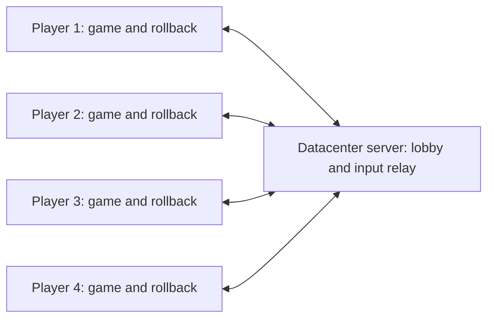

# Minimal dedicated-server lobby and player assignment

Status: macOS Online Battle screen is wired and locally exercised, 2026-10-25.
Four-process scripted rollback matches pass. Windows x64 support, cross-platform
determinism, physical-device identity, audio/rumble, and human playtests remain
open. No server has been rented or deployed.

## Implementation record

- Windows private channel: `MatchChannel` now supports a local duplex byte pipe
  with owner-only access, remote connections refused, and initially non-inheritable
  handles. It uses explicit nonblocking polling with the existing 240-byte
  records and 2,048-message queue cap; no pending I/O retains moved buffers.
  The shared channel regression now runs in CTest on both platforms and checks
  fragmentation, batched records, input/event validation, queue saturation and
  ordered recovery, moves with pending receive/send data, and closure from
  either end. All seven Windows Clang and MSVC Release CTests and all nine Mac
  lobby CTests pass. The Mac session, channel, and input-policy tests also pass
  at O0/O2. Windows process creation and
  handle inheritance are the next step; this channel test uses both endpoints
  within one process and does not yet certify an owned Windows game session.
- Windows foundation (2026-10-25): SSH access to `dosktep2025` is verified.
  Its original workspace contained only `access-check`; all new files are isolated
  under `C:\Users\ldeme\Dev\bomberman64\online-port`. The host is Windows 11 x64,
  Ryzen 7 9800X3D, 64 GB RAM, Radeon RX 9070 XT, with Visual Studio 2022 17.14
  and Windows SDK 10.0.26100.0. Portable CMake 3.31.6, Ninja 1.12.1, and LLVM
  19.1.3 were downloaded from their official releases into that workspace.
  Windows fingerprinting now uses the OS SHA-256 provider and a growing UTF-16
  executable-path buffer. Its explicit Windows x64 domain remains incompatible
  with Mac fingerprints until the exact pair passes game-state comparisons.
  The standalone server needed `NOMINMAX` to avoid Windows header collisions.
  All six Windows Release CTests pass with MSVC 19.44 and Clang 19.1.3: room
  lifecycle, real UDP lobby, clocks, input history, independent-loss relay
  recovery, and fingerprints.
  Fingerprint checks include known SHA-256/profile vectors, streaming, changed
  files, missing ROM, Unicode filenames, and executable identity; a relocated
  258-character executable path also passes, exercising buffer growth. All eight Mac
  lobby CTests pass; the rebuilt native Mac fingerprint also agrees with Python
  (executable SHA-256 `5bb47b6175483d97bd6f08d44dc9ba01a56c27c774cbc135a1f912badad4e8de`).
  Windows process/IPC ownership and the full game are still unported; these
  component passes do not establish cross-platform determinism or playability.
  LLVM's `llvm-mt` lacks libxml2, so use the installed Windows SDK's `mt.exe`
  explicitly through `CMAKE_MT` when configuring the Clang build.
  `tests/run_coroutine_replay.ps1` also passes with Clang at `/Od` and `/O2`,
  including 100 repeated 12-update restores, changed-input and omitted-stack
  controls, natural termination, retained destroy/recreate generations, and all
  80 process slots. Windows currently uses the correct full-native-stack copy
  fallback (about 40 MiB for this synthetic pool), not the arm64 live-tail
  optimization. This test excludes the game's OS scheduler, RAM, renderer, and
  audio. Logs are local under `build/experiments/windows-{lobby-msvc,clang-checks}.log`.
  Reproduce from an x64 Visual Studio developer PowerShell with CMake, Ninja,
  and portable LLVM on PATH:
  ```powershell
  cmake -S server -B build/lobby -G Ninja -DCMAKE_BUILD_TYPE=Release `
    -DCMAKE_C_COMPILER=clang-cl -DCMAKE_CXX_COMPILER=clang-cl `
    "-DCMAKE_MT=${env:WindowsSdkDir}bin/${env:WindowsSDKVersion}x64/mt.exe"
  cmake --build build/lobby
  ctest --test-dir build/lobby --output-on-failure
  ./tests/run_coroutine_replay.ps1
  ```
- The macOS launcher now includes Online Battle with server/name/local-port fields,
  four player/CPU rows, Ready, P1-only Start gating, Cancel, Leave, Back, and server
  round-trip display. It uses the background worker, actual fingerprints, and
  input-preference snapshots. Visual interaction verified connection, readiness
  clearing on a join, disabled one-player Start, a two-client real-game start with
  matching Ready digests, cancellation back to Lobby, Leave, and Back. The local
  port/Setup controls overlap was fixed and reinspected. Keyboard events now retain
  their queued modifier state, including Command editing shortcuts on Mac;
  Command-A replacement and invalid-port feedback were verified in the screen.
  Lobby asset changes trigger bundle refresh/re-signing. Full reconfiguration on
  this host required `TOOLCHAINS=com.apple.dt.toolchain.Metal.32023.883` because
  Xcode's default Metal lookup failed despite its component being installed.
  Final executable SHA-256:
  `e3823373cb6ff959e991394368e07286f105a3c102070395c6228ddbaf4793da`.
  On that unchanged image, `python3 tests/run_network_game.py match` passes all
  four complete three-round histories (corrections 19/36/32/34, finish 5403),
  `sh tests/run_battle_replay.sh` passes the full legacy suite and negative
  controls, and `python3 tests/run_fingerprint.py` agrees with independent SHA-256.
  This is a Mac prototype: audio remains muted, manual device assignments still
  need preservation across fresh processes, and live human matches are unverified.
- The application now has `LobbyWorker`, a background owner with a bounded
  16-command UI queue and copied roster/status views. It computes the actual
  executable/ROM fingerprint at Connect and rechecks both before every Prepare.
  No render-thread polling is needed to service the connection or game. All
  eight Release lobby CTests pass, including two fixture matches with no UI
  polling, CPU/Ready views, leave cleanup, and changed-ROM rejection both before
  the next match and on reconnect. Client and server share the pinned ENet CMake
  declaration. The worker currently uses the Mac fingerprint/POSIX owner; the
  Windows backend is the next platform task.
- Scope decision (2026-10-25): the user wants the first remote-play version to
  support both Apple Silicon macOS and an Intel/AMD Windows PC. Remote access to
  the Windows PC is available through SSH alias `dosktep2025`, with work under
  `C:\Users\ldeme\Dev\bomberman64`. Inspect existing files before uploading. This
  replaces the initial same-platform-only target, not the determinism gate.
  Port and test the process/IPC, snapshot/runtime, build, and fingerprint paths;
  compare the exact Mac/Windows build pair through the same startup, battle,
  and round-transition histories before permitting that pair to share a room.
  Current platform-specific fingerprints intentionally still reject unlike builds.
- macOS clients now expose `--online-fingerprint`, hashing the exact executable
  (including linked recomp/patch/runtime code) and stored ROM with SHA-256, with
  an explicit architecture/fixed-profile domain. The command starts no runtime.
  Standard SHA-256 vectors, multi-buffer files, swapped/changed inputs, missing
  files, and executable location pass CTest. `python3 tests/run_fingerprint.py`
  independently agrees with the native command on executable SHA-256
  `1e031f4a127feaffb38fcabe0806a03716e29698a4344f74ad34e3a9d650bbda`.
  `LobbySession` can revalidate compatibility before every Prepare; its regression
  changes compatibility after successful matches and confirms refusal before a
  child launches, with both connections retained. The UI must still wire the
  actual file check into that hook. Test transports still use their fixture token.
  This is build/profile identification, not a cross-machine or settings-audit pass.
- `src/online/lobby_session.hpp` now combines the persistent connection with the
  disposable game owner for application use. Its regular poll handles Prepare,
  exact-ready acknowledgment, local start epoch, uploads/relays, confirmed finish,
  cancellation, disconnect, and child failure. Missing the local start deadline
  aborts rather than starting behind the other players. A failed child preserves
  the lobby connection for retry. All six Release lobby CTests pass; the expanded
  application-owner fixture covers input transfer, local-preference handoff,
  repeated normal completion, loading cancellation, leave cleanup, missed start,
  failed launch, and crash. This owner has not yet been attached to a rendered
  Online Battle screen; its new orchestration tests use fixture children.
- The process owner now accepts a bounded local-input snapshot and an explicit
  physical port independent of the assigned online slot. The child imports only
  port modes, keyboard/controller bindings, sensitivity, calibration, and global
  deadzone, using the existing controls serializer/loader. Its fresh folder
  allows only the ROM and optional `online-input.json`; other settings, saves,
  directories, symlinks, oversized input files, and malformed snapshots are refused.
  The typed physical port overrides diagnostic environment values. Offline config
  serialization is unchanged. `python3 tests/run_controller_tests.py` passes 44
  calibration and 79 routing/config checks, including snapshot round trips and
  invalid-input cases. Owner/channel/policy checks pass at O0/O2.
  `BM64_SESSION_REAL_GAME=1 sh tests/run_game_session_tests.sh` cancels a real
  load and completes two matches, with changed input preferences in the second:
  initial RAM/register digests still match, both finish at 5401, temporary settings
  are removed, and personal settings stay untouched. Tested executable SHA-256:
  `ff0535b5d6fc377238d149eef1ea6461d45a72ab52954eb767b23e303da1ed4f`.
  Remaining input work: wire the snapshot into the actual lobby, preserve manual
  physical-device assignments across fresh processes (the existing config stores
  modes/bindings but not device identity), and verify live hardware. These tests
  use virtual SDL controllers or recorded inputs, not two human players.
- Lifecycle choice: persistent external lobby owner with one fresh game process
  per match. `src/online/game_session.{hpp,cpp}` implements POSIX process ownership,
  isolated settings/ROM copies, cleanup, loading deadline, cancellation, exit/crash
  recovery, and monotonically increasing match IDs. No native checkpoint crosses
  a process boundary. The private game acknowledgment channel is tested; the
  lobby UI is not built. A separate ENet connection owner is now tested below.
- `sh tests/run_game_session_tests.sh` passes at `-O0` and `-O2`: loading cancel
  before/after readiness, acknowledged start/finish, crash, failed launch,
  repeated launch, stale event rejection, malformed/duplicate events, loading
  timeout before/after readiness, cleanup, and a surviving local socket endpoint.
  The private channel handles fragmented/coalesced messages and peer closure
  without killing the owner. `BM64_SESSION_REAL_GAME=1` now cancels a real load,
  then completes **two real first-to-three matches** through the same owner. Both
  stop at Player Select boundary 1374 until Start, have identical initial guest
  digests, finish at 5401, and clean up their private settings. This is scripted
  lifecycle evidence, not a live-input, real-server, or cross-machine claim.
- Existing combined build (SHA-256
  `b6c4fec93b37134470f15fc56f6c8a94d1086fea05e9544fe6d1d21879d72326`): controller
  checks (44 calibration, 67 routing/config), 6,885 input timing checks at each
  optimization, coroutine checks, and the complete `run_battle_replay.sh` pass.
  This includes input/stack negative controls, boot handoff rewind, entry transition,
  400-frame replay, and the rolling history. Full-RAM baselines match across the
  existing independent runs. macOS game probes require audio/graphics access;
  the restricted invocation failed opening CoreAudio before simulation.
- Step 1 remaining: configuration/UI audit and two-machine comparison. Native
  continuation/runtime rollback is now exercised through the local full-match
  network test below; its comparable digest still does not certify portable native
  state across machines. The current process owner is
  exercised through a network integration test, not yet wired into the user-facing application.
- Comparable diagnostic: `python3 tests/run_independent_clients.py` passes on
  build `a0ee1058f277c7d23dc921ee4e8a4272b0947462fa5845efc52129bc75ed4eae`.
  Two fresh processes match all 747 boundaries (1599–2345), covering the menu
  handoff, battle entry, and active battle. A third fresh process changes P1's
  recorded input at 1950 and first diverges at 1951. Each also passes three
  same-process full-RAM/register restores across the entire 747-update window.
  `COMPARABLE_V1` retains all 512 MiB of RAM and every architectural register;
  only the understood `f_odd` self-reference is encoded by logical identity.
  Unsupported references fail. The separate diagnostic also records logical
  process/thread identity and clocks; it does **not** certify native continuation,
  runtime queue, or GPU state across machines. No arbitrary RAM range is excluded.
  Log comparison refuses incomplete/duplicate histories, changed executables,
  different executable hashes, or different input recordings (except the explicit
  negative control). `python3 tests/test_independent_client_logs.py` covers these
  rejection paths, so a Windows build cannot accidentally pass as the tested Mac build.
- Scene inspection exposed a real blocker: the normal threaded `--single-battle`
  handoff at update 1600 displays **Stage Select / Rock Garden**, not character
  selection. Capturing at the exact handoff is black because fast boot suppresses
  both display lists and screen updates; waiting for presentation alone cannot
  display a frame that was never drawn. With handoff 1400, a held capture at 1402
  visibly confirms **Player Select** in the deterministic runtime as well.
  Disposable captures are under `build/experiments/`; an online start acknowledgment
  with a scene predicate is still required before synchronized start.
- Loading timeout and owner-destruction cleanup now have focused regressions at
  both optimization levels. The only available second machine is Windows (user
  confirmed); matching Mac/Windows determinism and a Windows process backend are
  unproven. This does not satisfy the plan's same-platform two-machine gate.
- `BM64_BOOT_HANDOFF_FRAME=1400 BM64_CAPTURE=1 python3 tests/run_single_battle_probe.py`
  visibly reaches **Player Select**, before the scripted A press at 1500. The
  default update-1600 handoff is preserved for existing fixtures; its log now
  correctly says the scene is unverified. `BM64_TRACE_MENU=1` records the active
  menu process for investigation, not as a certified scene predicate.
  Source inspection shows overlay 3/3 helpers at `0x800432A0` and `0x800432F0`
  OR all four controllers together. The accepted P1-only shared-menu behavior
  therefore required the explicit input filtering implemented below; routing alone is insufficient.
- `--online-test` now requires a fresh isolated folder containing only the ROM,
  so existing saves, settings, and gameplay mods cannot enter startup. It forces
  all seven cheats off, refuses their setters, hides the cheat form, and keeps
  game-facing aspect-ratio queries at the original ratio. Ordinary offline mode
  does not enable these overrides. `python3 tests/run_match_settings.py` passes:
  attempts to enable all cheats at boundary 1940 leave the subsequent full-RAM
  and canonical-register hashes unchanged; personal settings remain byte-identical.
  Real-process lifecycle tests pass with this mode enabled. Remaining configuration
  paths and the visual disabled-cheat UI still need review; this is not a complete
  immutable-settings or playable-client claim.
  Updated build `aeb55dcf653455ebed1800eff36e3b0136dd4e033eacffa595088601f62dfa64`
  also passes the complete `run_battle_replay.sh` suite and both optimization levels
  of the input timing and comparable-context unit checks.
- The recorded battle eliminates three players by 2220 and enters overlay 17
  by 2340, remaining there through a no-input run to 6000. This narrows the result
  transition investigation. A held capture at 2500 shows P4 receiving a star;
  P1's A at 3000 enters another four-human battle by 3060. **Overlay 17 alone is
  a round-result signal, not match completion.** Do not return to the lobby there.
- `python3 tests/run_online_transition_tests.py startup` passes two independent
  histories at 1381–1580, three full-state restores per process, and an altered-input
  negative control. It covers Player Select through Stage Select, including the
  earlier boot handoff. The menu-process trace guards this specific tested fixture;
  it is not a general-purpose scene detector.
- `python3 tests/run_online_transition_tests.py round` covers result acknowledgment
  through the next battle (2941–3180): independent full-RAM/canonical-register
  histories match, three same-process restores pass, and omitting native stacks
  diverges. `tests/fixtures/battle-next-round.txt` adds the result acknowledgment.
  Both transition checks used build
  `2aec316eddf5b88cc7ba9962e8aaa7735ecc29109d0fae208749da988aef339e`.
  Held-frame captures now drain pending presentation first; a four-update replay
  with a held capture on every traversal still passes full-state comparison.
- User confirmed the first version uses fixed player colors and P1 advancing the
  existing shared menus. Lobby assignments lock human/CPU seats; independent
  character-selection controls are outside this first version.
- Player Select now has explicit entry/input-loop/exit hooks in `bm64.us.toml`.
  The marker is captured/restored with the simulation and included in both state
  digests. `BM64_BOOT_TO_PLAYER_SELECT=1` (also the `--online-test` default) ends
  scripted boot at the first boundary after the real input loop is reached,
  update 1374 in this fixture. A capture at 1402 confirms the visible screen;
  the 1301–1580 startup regression covers entry, boot handoff, and exit at 1501.
  It passes independent histories, three full-state restores, and changed-input
  negative control. The old register-trace heuristic is removed.
- `tests/fixtures/battle-finish.txt` completes three ordinary rounds using controller
  input alone. P4 reaches three stars, then P1 acknowledges the final round at
  5400. Boundary 5401 changes from round-result scene 20 to winner scene 21;
  a capture at 5550 shows WIN. `online::BattleState::complete()` accepts only the
  tested first-to-three single-battle winner, checking overlay, scene, preset,
  and scores; the third star on the round-result screen alone is insufficient.
  `python3 tests/run_online_transition_tests.py match` passes two independent
  histories at 5381–5540, three full-state restores each, and the omitted-stack
  negative control. Both updated startup and match checks used build
  `d13b9448088ab0f2ef6e223e5cb042a868c6ab33f941276e348ee1c9b8191d73`.
  Battle-state assertions, log-validation tests, input-timing and coroutine checks
  also pass; the last two run at both optimization levels.
- Music/effects volume is applied inside guest libaudio events and changes RAM.
  Online match overrides now keep music/effects/voice balance at 100, refuse their
  setters, and hide those controls; Main Volume remains adjustable on the host.
  `python3 tests/run_match_settings.py` passes four real-game runs: online cheat
  and sound changes leave full RAM/register state unchanged, while the offline
  sound-change negative control diverges. Main Volume remains adjustable in both
  modes and personal settings remain untouched. The disabled sound UI still needs
  visual inspection; live audio output/replay deduplication remains step 3 work.
- The session owner now receives a bounded Ready message with match ID, actual
  frame, and comparable state digest. Start must acknowledge that exact state;
  the child stays suspended at the game-loop boundary while waiting. A valid
  Finished event ends the disposable child and returns the owner to Lobby.
  Wrong-match, duplicate, out-of-order, or disconnected-channel events abort and
  clean up. Ordinary child exit cannot be mistaken for normal match completion.
  IPC is private to one process pair, separate from a future network protocol,
  and never sends native checkpoints. The owned path currently accepts scripted
  diagnostic inputs and refuses diagnostic restores; live rollback completion
  now uses the confirmed frontier in network mode, as tested below. No online UI is wired yet.
  Real lifecycle proof used unchanged build
  `ef1b91d0ac4c8f2bb64b7289ababf94ad806ae1e5d850fd291f298a0ee96d3da`.
  This build also passes the complete `sh tests/run_battle_replay.sh` suite:
  1/4/8/12-update restores, 400-update lifecycle, boot and battle entry, both
  negative controls, independent overlapping RAM hashes, and rolling history.
- Fixed colors and human/CPU seats now apply before Player Select builds its rows.
  `BM64_ONLINE_HUMANS=2|3|4` is validated, and the owner supplies the agreed count.
  P1 alone can confirm shared menus/results; directions, seat/costume edits, and
  the ROM pause menu are blocked online. CPU pads stay neutral. Offline controls
  are unchanged. Checkpoints now restore the overlay used by this input policy.
  The layout checks pass all six 2/3/4-human baseline/interference runs, two round
  transition runs, and an offline negative control (first divergence 1401), each
  with full-state restores. A held two-human capture visibly shows MAN/MAN/COM/COM.
  O0/O2 input-policy and owner checks, two complete real owned matches, and a
  400-update rolling-history check pass on unchanged executable SHA-256
  `379c51898ff87054a26f05275bab2b0bad22fe234aaf795518aa851546ce1e85`.
- Step 2 server preparation has begun while the remaining step 1 gates stay open;
  no playable-network claim is made. Preserve concurrent renderer/runtime experiments.
- `server/` builds independently with ENet 1.3.18 pinned to upstream commit
  `2662c0de09e36f2a2030ccc2c528a3e4c9e8138a`. The bounded, versioned control
  protocol and room model implement compatibility-token rejection, serialized
  four-seat assignment, revisioned Ready/Start, matching initial digests, future
  start epoch, cancellation, finish agreement, timeouts, and disconnect recovery.
  Release CTest passes pure room/protocol checks and real loopback UDP tests with
  2/3/4 clients, repeat matches retaining identities, load failure, full-room and
  incompatible joins, stale Ready, and disconnects. Local UDP tests require socket
  permission. This is control-plane evidence only: fingerprint generation,
  lobby UI and game rollback integration remain unimplemented. There is no deployment.
- `LobbyClient` now owns the persistent ENet connection, validates roster identity,
  tracks bounded clock probes, and rejects late starts while keeping the room
  connection. Three fresh samples are required before acknowledging loading;
  offset estimates use the lowest RTT in an eight-sample window. POSIX UDP
  sockets are close-on-exec so disposable games cannot inherit the connection.
  Four Release CTest targets pass, including fixture game children completing
  repeat matches over real connections and explicit late-start cancellation.
  Protocol/room tests also pass AddressSanitizer/UndefinedBehaviorSanitizer;
  clock arithmetic passes O0 and Release checks. The optional real-game variant
  launches **two simultaneous real clients with two humans/two CPUs**: identical
  initial state across clients and restarts, start/cancel twice, then rejection
  of a deliberately late third start, with connection identities retained and
  settings cleaned. This does not prove a completed two-human/CPU match or live
  inputs. The current bridge is an integration test, not a user-facing lobby.
  Cross-machine clock mapping and game-state agreement remain untested.
- Input-history model and bounded input codec are implemented independently of
  game checkpoints. Boundary F precedes input F; inputs 0/1 are neutral and a
  physical sample at F belongs to F+2. Repeated sampling while stalled cannot
  replace it. The server tracks every human receiver's contiguous frontier for
  every human stream; CPU seats do not participate. Progress stops 12 updates
  beyond their shared minimum, fitting the 16-checkpoint and 32-input rings.
  Identical uploads are forwarded again even after server receipt. Tests cover
  conflicting/forged inputs, bounded packets, independent P2 delay/P4 reorder and
  duplicates, 400 updates through ring wraparound, and comparisons to an
  order-sensitive all-inputs-known oracle. A focused test loses only server-to-P3
  traffic, stalls all clients, then recovers solely by resending already-accepted
  inputs without advancing any simulation. Another injects P3 during P2 replay
  and requires a second restore from the earliest affected frame. O0/O2 and
  address/undefined-behavior sanitizer checks pass. These are model tests, not
  ROM rollback; actual ENet-input integration is recorded below.
- The server and `LobbyClient` now carry inputs over separate unreliable sequenced
  ENet channels 1–4. Each stream is bound to its connection's assigned slot, and
  exact repeats are forwarded immediately. The server rejects an unconfirmed
  finish and aborts after five seconds without shared confirmed progress, retaining
  connections in Lobby. Six Release CTest targets pass, including four real
  connections carrying 180 simulated updates with independent delivery delays,
  duplicates, and discarded server-to-P3 relays, then correction to an all-inputs-
  known oracle. Loss is injected at the receiving client delivery boundary, not
  by OS packet shaping. Raw connection tests reject slot impersonation and
  conflicting replacements. Real-game startup/cancel integration still passes on
  unchanged executable `379c51898ff87054a26f05275bab2b0bad22fe234aaf795518aa851546ce1e85`.
  At this stage the ROM still used recorded inputs directly; the next record
  connects the private channel, followed by the actual checkpoint adapter.
- Private owner/game IPC is now version 2 with bounded input-upload/relay records.
  The owner validates the assigned local slot, supplies it through the isolated
  launch environment, drains a bounded incoming queue, and rejects stale-match
  inputs. Nonblocking writes retain partial records in a capped 2,048-message
  queue; a socket-buffer saturation test drains them in order without loss. This
  matters on macOS, whose observed default local socket buffer is only 8 KiB.
  Fixture game children now exchange assigned inputs through IPC → ENet server →
  IPC before completing, and wrong-slot child uploads abort. O0/O2 ownership and
  channel tests pass. Rebuilt game SHA-256
  `91b58d8b6fe7dedb29fd5f11886462ca88694fcc36a97c02b9959c4d06b4a24a`
  passes two normal real first-to-three matches and the real two-client startup/
  cancel checks; all six lobby CTest targets pass. This prepared the real game
  callback and checkpoint integration recorded next.
- `BM64_NETWORK_INPUT=1` now connects the actual game scheduler to the private
  input channel and `RollbackInputs`. Each physical sample is quantized once and
  scheduled two updates ahead in its assigned online slot; diagnostic recordings
  use that same path. Repeated controller reads use latched pads. The owner/game
  connection keeps polling and retransmitting while pacing, replaying, or stalled.
  Corrections restore the earliest required native checkpoint, refresh the ring,
  and suppress intermediate presentation. Network history never rewinds with the
  game. Input callback tests now pass 7,047 checks at both optimization levels,
  including exact N64 axis round trips, slot isolation, and shared-menu policy.
- `python3 tests/run_network_game.py all` passes four actual game processes in
  baseline, independent-delay/loss, and changed-input runs. Full 512-MiB RAM and
  canonical-register digests agree at every verified boundary from Player Select
  through battle and round results. The baseline has no corrections; delayed
  clients perform 17/28/30/29 corrections and match it. Reversing P1's movement
  first changes the verified state at relative frame 600 while all clients still
  agree. Loss is injected at the owner delivery boundary, including a half-second
  server-to-P3 outage, not by OS packet shaping. Verification pauses at fixed
  boundaries and hashes full RAM, so this run is not a performance measurement.
- `python3 tests/run_network_game.py match` now completes a real four-human,
  first-to-three battle over the same delayed relay: 24/40/38/40 corrections,
  matching states through all rounds, and normal completion at guest frame 5403
  (relative boundary 4029). All connections return to Lobby and private settings
  are removed. The initial run exposed a real bug: discovering the winner during
  replay reported a later predicted head. Completion now stops at the **first
  confirmed winning boundary**, including inside replay; the regression requires
  that path. These checks use game SHA-256
  `6b5dc17b6d7dee536c0bcfe875e4efcb4c692fb833f234bf0236f15890a29414`.
  The same build also passes the complete `run_battle_replay.sh` suite (full RAM
  and register restores, both negative controls, independent-process overlap,
  boot/entry transitions, and rolling history) and two normal real matches in
  the earlier scripted process-owner test. Normal offline input timing remains
  covered by the existing checks alongside the new network latch assertions.
  This remains scripted input on one Mac, with audio/rumble muted. Live controller
  configuration, the lobby UI, compatibility fingerprint generation, visual-history
  inspection, real audio/rumble, cross-machine validation, and the remote human
  playtest remain required. The physical input branch exists but is not yet tested
  with live players.

## Goal and boundary

Let two to four people join one private room with fixed player colors and finish real
Bomberman 64 battles through a rented datacenter server. Use this to judge feel
before doing more speculative renderer optimization.

The server owns the room, assigns players, coordinates starts, and relays inputs.
Every client runs the full game and its own rollback. The server does not run the
ROM, render frames, hold checkpoints, or decide battle outcomes. This gives all
four players the same networking role without requiring a headless recomp port.
A server that independently simulates and arbitrates gameplay would be a separate,
larger project. This first version is for trusted friends, not competitive anti-cheat.



## What players see

One **Online Battle** screen has a server address, display name, and Connect button.
The first deployment uses one room at that address. There are no accounts, room
browser, matchmaking, or room-creation service.

After joining, show four rows containing player number, name, connection status,
and Ready status. Unoccupied rows say **CPU**. Each player has Ready and Leave;
Player 1 also has Start, enabled only with two or more humans and everyone ready.
Show connection delay to the server, explicitly labeled as such.

Start launches the game's existing single-battle character selection with the
agreed human/CPU layout and fixed player colors. Player 1 operates the existing
shared menus; other players cannot change those menus or human/CPU assignments. The first version uses one tested battle preset, with CPU
players filling unused slots; do not duplicate stage/rules menus in the lobby.

## Exact assignment rules

| Event | Server behavior |
| --- | --- |
| First accepted connection | Assign P1; this player gets permission to press Start. |
| Next connections | Assign P2, then P3, then P4. |
| Fifth connection | Reject with “Room full.” Do not replace anyone. |
| Player leaves before loading | Remove them and compact the remaining join order into P1…Pn. Publish the new roster and clear everyone's Ready status. |
| New player joins | Append to the roster and clear everyone's Ready status. |
| Loading or playing | Lock membership and assignments. Reject new joins with “Match in progress.” |
| Match ends normally | Keep assignments and connections; return everyone to the lobby with Ready cleared. |
| Player disconnects during loading/play | Abort that match and return connected players to the lobby. Compact slots and require everyone to ready again. |
| Server restarts/disconnects | End the session; clients reconnect manually. |

The server serializes joins, so simultaneous requests cannot claim the same slot.
Names are labels, not identities. Each connection gets a server-issued identity;
only the server assigns its player slot. Publish the entire small roster with an
increasing revision number. Ready and Start refer to that revision, so a delayed
message cannot approve a different roster.

A player's chosen local controller or keyboard always drives their assigned
**online** slot. A joining person's first physical controller can drive P3; it
must not accidentally drive local P1 as well. Initial scope is one human per
client. CPU slots are simulated identically on every client and send no inputs.

P1 is just the person allowed to press Start and operate existing shared menus.
P1 gets the same two-update input buffer and prediction rules as everyone else.
If P1 leaves the lobby, the next player becomes P1; there is no server migration.
No seamless reconnect, mid-match replacement, or switching a disconnected human
to CPU is included initially.

## Room lifecycle and synchronized start

Use three states: **Lobby → Loading → Playing → Lobby**. Every match has a fresh
match ID; packets from an earlier match are ignored.

1. On connection, check protocol version and a compatibility fingerprint covering
   game/ROM hash, recomp and patches, runtime version, deterministic configuration,
   and supported client platform. The first remote-play target is a tested
   Apple Silicon macOS/Windows x64 build pair (user decision, 2026-10-25).
   Admit only the exact fingerprints of that validated pair; platform identity
   must remain visible rather than pretending the two binaries are identical.
   Reject mismatches before allocating a playable seat. Do not send ROM data.
2. P1 requests Start for the current roster revision. The server validates all
   Ready flags, locks the roster, and publishes the match ID, ordered roster,
   fixed battle preset, deterministic seed/time origin, and two-update input buffer.
   Revalidate and freeze the gameplay configuration for this match; the connection-
   time fingerprint alone is insufficient.
3. Every client starts a fresh deterministic game session with isolated match
   settings/save state. It reaches the same boundary immediately before live
   character-selection input. Controller presence and CPU settings must match.
   Do not synchronize local native checkpoints across machines: they contain
   process-specific addresses.
4. Clients acknowledge the agreed configuration and comparable initial-state
   digest. The server requires all acknowledgments before committing the start.
   A load failure, disconnect, mismatch, or 30-second loading timeout returns the
   room to the lobby with a useful error.
5. Send a future server-time start epoch after measuring client clock offsets and
   round-trip delays. Clients map it to local monotonic time. Handle a late start
   explicitly rather than silently granting one client a lead. Frame numbers,
   not wall-clock equality, identify game inputs; bounded lead prevents drift.

In step 1, choose and document the actual session lifecycle: a persistent lobby
and connection owner with a fresh game process per match, or an explicit runtime
teardown/reset path. Use the smallest approach that passes the lifecycle tests.
The current runtime starts once, `quit()` exits the application, and replay probes
terminate the process; calling `start_game()` again is not a reset implementation.
Prove **start → abort/finish → lobby → start again**, including cancellation during
loading, before building the lobby around that choice. Keep the room connection
and identity alive, release old runtime/checkpoint state, and reject old-match
events after restarting. Exercise ownership with a local test session in step 1;
verify real connection retention in step 2. If using a separate game process, its
crash must return the surviving session owner to the lobby rather than leave a
playable seat stuck in Loading.

Define and test the actual character-select boundary before networking it; the
current boot-handoff marker alone is insufficient.
Initially, Exit Online Battle cancels the match for everyone. Detect normal match
completion at a confirmed simulation frame, then have all clients return to the
external lobby. This needs an explicit round/match-transition integration test.

Match settings are immutable from Loading until the match ends. Disable cheats
and gameplay mods for the first version, and prevent local settings UI or config
reloads from changing simulation-affecting values. Allow local volume, display,
and controller calibration changes only where they do not change the shared
simulation. Use isolated overrides without overwriting personal settings; restore
normal settings on completion, abort, or failed loading. Test an attempted mid-match
cheat change and verify both simulation consistency and settings restoration.

## Input transport and rollback

Use one small C/C++ server executable, built independently of the game and renderer.
The proposed transport is pinned upstream **ENet**, providing reliable control
messages and separate UDP channels without writing connection management from
scratch. ENet documents reliability and independent channels in its
[design notes](https://github.com/lsalzman/enet/blob/master/docs/design.dox);
its [upstream repository](https://github.com/lsalzman/enet) provides the implementation.
Pin and test a specific revision during implementation; do not add a second transport.

- Use reliable ordered control messages for joining, roster snapshots, readiness,
  preparation/start, and match termination. Bound message sizes and queue lengths.
- Send frame-numbered controller inputs over a separate unreliable channel per
  player stream, with recent inputs repeated in each packet. Start with a 32-frame
  input history and a packet size cap below 1,200 bytes. Continue resending while
  simulation is stalled, so loss can recover without advancing the game.
- The server binds each input stream to its connection's assigned slot. Validate
  frame bounds, input ranges, match ID, and size; reject conflicting replacements
  for an already accepted slot/frame. Forward accepted inputs immediately to the
  other clients; do not wait for all four inputs or batch on a server frame tick.
- Identical repeats within retained history are valid and must be forwarded again,
  not discarded merely because the server already accepted that slot/frame. This
  repairs loss on the server-to-client leg. Clients deduplicate identical inputs
  without applying them twice. Keep resending on a bounded cadence while stalled;
  retire input history only after the receiving clients' contiguous acknowledgments
  make it safe. A server receipt alone does not prove delivery to every client.
- Clients sample their own inputs once and schedule them two updates ahead. They
  do not wait for a server echo to apply their own input. Remote predictions hold
  the last known input; corrections restore the earliest affected checkpoint and
  replay every update, presenting only the final result.
- Track contiguous received inputs and a shared confirmed frontier. Bound progress
  ahead of the slowest client's confirmed frontier, not just ahead of the server's
  receive position. An initial maximum of 12 speculative updates must fit within
  the existing 16-slot checkpoint ring, with a checked slot-lifetime invariant.
  The two-update input scheduling offset must be included in the history sizing.
- Stop advancing before needed history could be overwritten. Continue network
  service and show “Waiting for connection.” If progress cannot resume within five
  seconds, abort to the lobby. Do not discard missing inputs, silently enlarge
  input delay, or keep predicting beyond recoverable state.

The exact frame-boundary convention, acknowledgment fields, and history arithmetic
need focused tests before integration. They are not reasons to build a generic
network framework. Keep network input history separate from rollback state so a
restore cannot forget newly received packets. Network polling must remain active
during replay and loading, without injecting nondeterministic events into simulation.

Before playable two-client integration, add deterministic four-client input-history
and relay tests with independently scheduled deliveries: P2 late, P3 arriving during
P2's correction, P4 reordered or duplicated, checkpoint-ring wraparound, and stalled
retransmission. Drop only server-to-P3 traffic in one case: input already accepted
by the server must still reach P3 after recovery. Check the earliest required
rollback, corrected state against an all-inputs-known reference, and bounded
history/queues. Define neutral inputs for the initial scheduling gap and exclude
CPU slots from network acknowledgment requirements so startup cannot deadlock.

## Renting and running the server

Start with one small Linux VM in a region reasonably close to the group, one
server process, and one configured UDP port. No GPU, game ROM, database, web app,
or container orchestration is needed. Measure resource use before choosing a
larger instance; this plan does not depend on a particular provider or price.

For the first private playtests, restrict that port to the testers' public IPs and
run the service as an unprivileged user with automatic restart and bounded logs.
ENet is not an authentication/encryption system; do not treat a room name or a
plaintext join password as public-service security. If IP restrictions become
impractical, add an authenticated encrypted access layer before opening access
widely. This does not require account infrastructure for the first trial.

All clients connect outward to the server, avoiding a player-hosted inbound port
and peer-to-peer NAT traversal. A relay can increase travel time: an input follows
player A → datacenter → player B. Under approximately symmetric paths, half of
A's server RTT plus half of B's server RTT estimates that one-way route, before
jitter and processing. Measure it; the server does not eliminate distance or make
four-player rollback cheaper. The current fixture predicts all three remote pads,
but uses one shared delivery-gap schedule; it does not cover independent packet
arrivals or loss on individual relay connections.

## Implementation order and acceptance

| Step | Deliverable | Acceptance |
| --- | --- | --- |
| 1. Independent-client correctness and lifecycle | Choose and prove session restart/teardown; fresh deterministic startup and recorded-input replay on two independent processes, then two machines using the current shared/controller build. | Matching comparable state through character selection, battle, and round transitions; start → abort/finish → lobby → start again, including loading cancellation; immutable match settings and personal-settings restoration; existing full-state replay and negative controls still pass. |
| 2. Server, lobby, and input-history tests | Standalone server, four-seat roster, Connect/Ready/Start/Leave screen, revisioned assignments, compatibility rejection, and deterministic four-client delivery tests. | Automated 2/3/4-client joins, concurrent joins, full-room rejection, reassignment, stale Ready/Start, loading failure, and disconnect cases; independently delayed/reordered/duplicate inputs, server-to-P3 loss recovery, arrivals during replay, stalled retransmission, and history wraparound pass before step 3. |
| 3. Playable two-client battle | Live controller remapping, input relay, bounded prediction/catch-up, and match start/end. | Two people complete repeated matches; no slot mixing, desyncs, duplicate rollback audio, or stuck loading/round transitions. |
| 4. Four-client datacenter playtest | Same room and protocol with four humans on separate machines; controlled delay/loss plus a real remote session. | At least ten complete matches and 30 minutes of play; capture diagnostics and human feedback, including disconnect recovery. |
| 5. Evidence-based follow-up | Compare ordinary local, online with no late corrections, and real-network rollback. | Decide whether current feel is acceptable and identify the dominant measured problem before further optimization. |

Independent-process comparison needs a deliberate state representation. Keep the
existing full-RAM and register replay checks unchanged. Native pointers/stack
addresses cannot be compared naively across processes: normalize only understood
process-local references in a separate network diagnostic, retaining their logical
identity, or reject the unsupported representation. Test that this diagnostic
still detects deliberate divergence; never omit arbitrary RAM ranges to pass it.
Full-memory hashing is a correctness mode, not work to perform on every rendered
frame. Measure the overhead of any periodic live desync checks separately.

A playable match also requires enabling real audio and handling replayed audio and
rumble without duplicates; the existing experiment suppresses output. Record any
confirmed-audio delay separately. Verify that replay suppression preserves required
framebuffer results and completion events, and inspect visual history artifacts.
Neither transport nor a lobby solves those existing integration gaps.

For playtests record RTT/jitter/loss per connection, correction depth/frequency,
CPU and display deadline misses, frame-gap tails, held/displayed-state age, buffer
size, stalls, desyncs, and post-hitch recovery. Keep the buffer at two for comparisons.
Include several hundred correction events across fresh runs, keep 8/12 updates as
stress cases, and preserve the fully drained diagnostic. Report physical input-to-
photon latency only if actually measured; the previous ~66.7 ms figure is an estimate.

The earlier single-remote-stream four-update p99 was 17.54 ms; it does not establish
performance for the current three-remote-pad fixture or a real four-client session.
This is an experimental playtest milestone, not a declaration of reliable 60 Hz
support. Performance failure does not block collecting honest feel feedback;
desynchronization does block a valid match.

## Deferred until the prototype answers the feel question

Multiple rooms, player-selected slots, multiple local humans per client, spectators,
join-in-progress, seamless reconnect, public matchmaking/accounts, ranked play,
server-authoritative simulation, platforms beyond the requested Mac/Windows pair,
and adaptive input delay.
The fixed four-seat roster already supports two through four players without any
of these features. The immediate next implementation is step 1, followed by the
small server/lobby; further renderer optimization is deferred pending playtest data.
