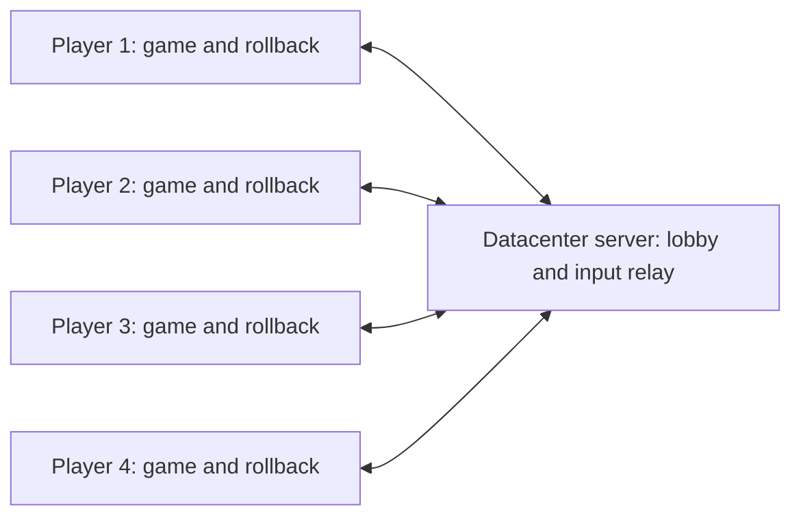

# Minimal dedicated-server lobby and player assignment

Status: macOS Online Battle screen is wired and locally exercised, 2026-10-26.
Four-process scripted Mac rollback matches pass; the full Windows x64 client builds.
Online processes render display-only by default, keeping GPU output out of game
RAM. Windows RX 9070 XT replays pass, and scripted Mac/Windows histories match on
every boundary, including a 20,994-boundary session. The cross-build transition
checks match too. Physical
controllers, real-device audio listening, and human playtests remain open. Rumble
may be disabled for the first online version (user decision, 2026-10-25);
preserve offline behavior. No server has been rented or deployed.

## Remaining work, in priority order

Fresh-session continuation instructions and diagnostic context are in
[`online-lobby-handoff.md`](online-lobby-handoff.md). The implementation record
below contains historical results; a successful older image does not certify the
current build.

1. **Finish display-only follow-ups.** Display-only is now the online default,
   and the per-frame presentation wait is gone (newest implementation-record
   entry). Spot-check visuals with MSAA and scaled resolutions, Player Select and
   the other stages. Windows rollback timing is now measured on a fast desktop
   (newest implementation-record entry); measure it on lower-end PCs too. Keep
   the full-RAM checks unchanged.
2. **Play a live Mac/Windows match.** P1 now chooses the stage online, and a
   validated Mac/Windows build pair can share a room (newest implementation-record
   entry). Next: a real Mac/Windows match through the relay with physical
   controllers, first on a home network, then more GPUs and machines. Never
   exclude framebuffer RAM to make a comparison pass.
3. **Finish playable two-person integration.** Replay-safe audio output exists
   and online rumble is silent; listen on real devices and rebuild Windows with
   them. Check physical controllers, input preferences/calibration, P1 menus,
   visual recovery, cancellation, and repeated complete Mac/Windows matches.
   Revalidate the existing lobby and relay against the resulting builds.
4. **Complete the remote four-person acceptance.** Prepare the dedicated relay,
   arrange four machines/testers, then run at least ten matches and 30 minutes of
   play with delay/loss, disconnect recovery, diagnostics, and human feedback.
   Measure the existing presentation wait and rollback recovery costs before
   further performance changes. No server has been purchased or deployed.

## Implementation record

- Mac controllers in online matches (2026-10-27). The first internet match
  (Mac host, Windows friend, keyboards) finished first-to-three normally. With
  physical controllers, every start then failed: the Mac match process logged
  "selected controller is unavailable or ambiguous" and both players saw "match
  owner/child disconnected". On macOS, SDL's device path ends in a per-process
  object address, such as `USB_057e_2009_0x105152c80` in the lobby and
  `…0x10561ec80` in a second process. The match process therefore never matched
  the lobby's path. macOS identities now leave the path empty and use GUID and
  serial, or GUID and name when there is no serial. The rule that exactly one
  device must match still holds. Windows HID paths name the device interface;
  a two-process SDL probe on the Windows PC returned identical paths.

  A throwaway live-input peer reproduced the failure on the old Mac build, with
  a real Switch Pro Controller and the user's controls. The fixed build started
  the match and matched the scripted peer at every checkpoint. The controller
  tests pass, with a new check that macOS identities omit the path (run with
  `SDL_JOYSTICK_HIDAPI=0 SDL_JOYSTICK_IOKIT=0 SDL_JOYSTICK_MFI=0` while a physical
  pad is attached, since the test expects exactly its four virtual pads). The
  Mac startup, match, and round transitions pass and match Windows `ff0c553d…`
  under `--cross-build`. New validated pair: Mac `c7c05089…` (fingerprint
  `26773ddf…`) and Windows `ff0c553d…` (fingerprint `0ed3dd6b…`). Each match
  overwrites `online-match.log`, so the successful match's log was not kept.

- Windows snapshots copy only changes (2026-10-27). The first live match over
  the internet (Mac host, Windows friend) ran at about 5 fps. The host's log
  showed every rollback pinned at the 12-frame prediction limit, waiting on the
  Windows peer. On Windows, each snapshot copied all 512 MiB of guest RAM and the
  whole of every coroutine stack; the 16-slot ring held 8.9 GB. Mac snapshots
  share RAM pages through `mach_vm_remap` and copy only live stack tails, so they
  were unaffected.

  With `patches/runtime-write-watch.patch`, Windows allocates guest RAM with
  `MEM_WRITE_WATCH`. `CheckpointMemory` then stores pages as reference-counted
  blocks shared between images, and stores all-zero pages as nothing. A table
  keeps the newest block that still matches each source page, so a written page
  is copied once and later captures share it. A restore copies back only pages
  that may differ, and the restored pages stay shared. `CheckpointStack` now reads
  minicoro's saved `rsp` on x86-64, as it already read `sp` on arm64, so only the
  live tail of each stack is copied. In a battle, guest RAM holds 2.1 MiB of
  non-zero pages and about 0.3 MiB change over 16 frames, identically on both
  platforms. The Mac paths are unchanged; the rebuilt Mac binary has identical
  code and data sections, so the Mac build `9c13e03a…` stays valid.

  *Windows timing* (Ryzen 7 9800X3D, 64 GB; `run_checkpoint_performance.sh` and
  `run_catchup.sh perf` setups, display-only, ms):

  | | Full copies (`1548dc14…`) | Shared pages, stack tails (`ff0c553d…`) |
  | --- | --- | --- |
  | Snapshot, p50 / p99 | 15.9 / 39.0 | 0.31 / 0.69 |
  | Restore, p50 | 16.0 | 0.56 |
  | 4-update rollback window, median | 83.8 | 5.5 |
  | 12-update rollback window, median / p95 | 215.0 / 226.9 | 10.2 / 13.7 |
  | 16-slot ring memory | 8.9 GB | 7.6 MB |

  An intermediate build that tracked written pages per image without sharing
  them (`75298878…`, briefly distributed) took 0.72 ms per snapshot and 408 MB,
  almost all of it full stack copies.

  *Validation.* `checkpoint_memory.cpp` runs the shared-page path on Windows. It
  covers restoring a slot, then capturing and restoring it again. It also checks
  that ring images share pages and that pages written back to zero store
  nothing. It passes on both platforms, as do the coroutine stack replay tests
  (Windows `/Od` and `/O2`). On Windows image `ff0c553d…`, these pass:
  - startup, match, and round transitions, including their negative stack
    controls; each matches the Mac histories under `--cross-build`;
  - the 400-frame rolling ring replay;
  - continuous 4- and 12-update rollbacks with full RAM/register verification;
  - 34 verified 12-update catch-up windows;
  - the negative input control, which diverges at frame 2083 as on the Mac.

  A live LAN match through `bm64-lobby` matched on all 31 checkpoints to frame
  6,000. The LAN was too fast to trigger rollbacks, so rollbacks over a real
  network are still unexercised. New validated pair: Mac `9c13e03a…`
  (fingerprint `0d8480e7…`) and Windows `ff0c553d…` (fingerprint `0ed3dd6b…`).

- Cross-machine rehearsal (2026-10-26). `tests/network_peer.cpp` (CMake target
  `network_peer`, Mac and Windows) is one scripted player that joins a real
  `bm64-lobby`. Over the home LAN, the server ran on the Mac and accepted the
  validated pair's two fingerprints. A Mac peer and a Windows peer joined,
  loaded, and played through the relay. A 1,000-frame run matched on every
  common checkpoint. A longer run, two humans plus two CPUs, matched on all 88
  checkpoints to frame 17,400 (about five minutes). That run then stalled on a
  medal screen, as expected: its four-human script's P1 A presses no longer lined
  up with the rounds. All 10 lobby CTests pass on Windows with current sources.
  Note: the Windows game resolves assets from its working directory, and a
  match child inherits the launcher's. Start the Windows game from its own
  folder; setting the child's working directory to the executable's folder
  would remove this trap, but it changes the Windows fingerprint.

- Online stage choice and Mac/Windows pair admission (2026-10-26). In the
  single-battle route, overlay 13 shows Player Select, then Stage Select. A new
  checkpointed flag, `player_select_passed`, is set when Player Select is left,
  and it is part of the full-state digest and comparable state (format word 3).
  After it is set, P1's A and left/right on the stick or D-pad pass the online
  filter; every other menu input stays neutral. Stage index is settings
  `+0xa0` (`0x802ac700`: 0 Rock Garden, 1 Up and Down, 2 Pyramid), found by
  diffing RAM dumps. `run_match_layouts.py stage` checks P1 picking Pyramid
  (overlay 88) and P2's identical presses changing nothing, each with full-state
  replay across Stage Select. The interference fixture now tries only up/down
  for P1 after Player Select.

  `bm64-lobby` accepts one to four client fingerprints, so one validated
  Mac/Windows build set can share a room. Duplicates and bad values are refused.
  `run_fingerprint.py` now prints the verified fingerprint; `server/README.md`
  gives the pair validation steps. Validated pair: Mac executable `9c13e03a…`
  (fingerprint `0d8480e7…`) and Windows executable `1548dc14…` (fingerprint
  `c90b4fd0…`), with the US ROM. Their startup, round, and match histories
  match under `--cross-build`. On the Mac image all suites pass, including
  layouts, match settings, network games, and lobby tests. `run_network_game.py
  all` failed once on its baseline-has-zero-corrections timing guard while the
  host was busy, then passed alone; `replay_input_timing.cpp` needed the new
  flag. Windows passed startup, round, and match transitions. A live
  Mac/Windows lobby match has not been played.

- Display-only by default; per-frame presentation wait dropped (2026-10-26).
  Checkpoint/online processes now render display-only unless
  `BM64_RENDER_TO_RAM=1`, which is kept for render-to-RAM diagnostics and older
  performance runners. Owned (network) matches refuse that override, so clients
  on one build cannot run different modes. The wait for submitted presentation
  work before each display list now applies only to render-to-RAM, the only mode
  where GPU output is guest state. Offline play is unchanged.

  *Timing* (`run_catchup.sh perf` setup, Mac, serial, two runs of 100 windows
  each). Median replay work per rollback window, excluding the final presentation
  wait that this harness paces to the display (ms):

  | Updates replayed | Render-to-RAM + wait | Display-only + wait | Display-only, no wait |
  | --- | --- | --- | --- |
  | 4 | 9.5 | 6.9 | 3.6 |
  | 8 | 16.1 | 11.5 | 6.6 |
  | 12 | 22.4 | 17.2 | 9.6 |

  Display-only skips the native render, its GPU sync, and the RAM writeback.
  Dropping the wait also stops the simulation from stalling on presentation, so
  replay costs about 0.8 ms per update instead of about 1.9. Tails are noisier:
  some no-wait runs have p95 near 18–21 ms, so measure on Windows and on lower-end
  machines before relying on the margin. Window totals including the paced final
  present stayed near 32 ms in every mode.

  *Validation.* With these defaults, Mac image `820e4b3b…` passed all 22 suites
  in `STATE_REPLAY.md`. That covers the unit suites, lobby, startup and
  single-battle probes, battle replay, catch-up verification, real session-owner
  matches, independent clients, match settings, match layouts,
  `run_network_game.py all` and `match`, and the real-game lobby. Windows image
  `849d35c5…` passed startup, round, and match transitions twice each. Its
  histories match the Mac's under `run_online_transition_tests.py --cross-build`
  for all three. The final sources (temporary A/B switch removed; Mac `60702fe4…`,
  Windows `f20e2f7d…`) passed startup on both and `run_network_game.py all` on Mac,
  and the cross-build startup comparison still matches.

- Display-only online rendering (2026-10-26): with `BM64_DISPLAY_ONLY=1`,
  checkpoint/online processes set RT64's `renderToRAM` off. The GPU still draws
  the screen, but no GPU output is written into game RAM, so all 512 MiB stay
  hashed and none of it depends on the host GPU. Offline play is unchanged.
  Audit image `ba747c60…` (writeback probe plus the switch); "masked" is normal
  mode with GPU-written bytes masked, as in the audit below.

  | Fixture (boundaries) | Display-only vs normal (masked) | Windows RX 9070 XT vs Mac, display-only |
  | --- | --- | --- |
  | Startup through Player Select (1,584) | identical RAM and registers | identical full RAM and registers |
  | Three-round match to scene 21 (5,474) | identical; same `MATCH_COMPLETE` 5401 | identical |
  | `rollback-inputs` default stage and CPU extra (3,254 each) | identical | — |
  | Pyramid (3,254) | identical | identical |
  | Pause mid-battle on Pyramid (2,462) | identical | identical |
  | Generated nine-round Pyramid session, match end at 10,669, post-match menus (20,994) | identical | identical to Mac normal-masked on all 20,994 |

  Each run also passed its checkpoint replay. On the same Windows image, the
  display-only startup transition test passed 9/9 against 2/8 for normal mode.
  Normal-mode failures were the known framebuffer-page divergence (0x11c000,
  0x21c000). Normal versus poisoned writeback also stayed identical on the new
  fixtures (Pyramid, pause, and the 20,994-boundary session).

  *Visuals.* A disposable readback dumped the target the present queue shows.
  The first comparison, 401 frames every 30 boundaries of the long session at 1x
  without MSAA, found two differing frames. A flashing player's gray phase,
  every 6th boundary, was missing in display-only mode. Cause: RT64 evicts
  textures on the HLE thread right after submission, by last-use age. The native
  renderer marks textures used during submission; display-only marks them only
  when the workload queue draws later. A texture used every 6 boundaries was
  evicted just before its draw. `patches/rt64-display-textures.patch` marks
  sampled textures used at submission in the display-only branch. With it, all
  401 frames are pixel-identical to normal mode, and display-only histories still
  match normal masked RAM (match, pause). Remaining visual gaps are MSAA and
  scaled resolutions (only one 1280×960 spot check), Player Select (not
  presentable at the dumped boundaries), and other stages.

  *Coverage notes.* `single-battle-stage-third.txt` and `single-battle-pause.txt`
  are new single-battle fixtures. Pause is blocked online, so it is covered only
  for safety. The older `rollback-stage-*` extras are timed for the full-boot
  route and do nothing after the single-battle handoff. Each online match runs in
  a fresh game process (`MATCH_FINISHED` exits), so rematches from the lobby start
  from boot and carry no prior-match state. The host settings menu cannot reach
  guest state in this mode. Diagnostics are archived locally in
  `build/experiments/display-only-diagnostics.patch`; clean Mac image
  `32492b43…` passes the display-only startup, round, and match transition tests.
  Clean Windows image `f18c2745…` passes them too: startup 3/3, round 2/2, and
  match 2/2, each with full-state replay and its negative control.
  The checkpoint presentation wait is still in place; with no GPU writes to
  guest RAM, it may now be removable, which needs measuring.

- Framebuffer-consumer audit (2026-10-26): no game state observed consuming GPU
  output. RT64's default `renderToRAM` writes native color/depth results into
  game RAM, so GPU differences become state differences. This audit asks whether
  anything that matters reads those bytes.

  *Method.* A disposable probe can invert every byte that
  `Framebuffer::copyNativeToRAM` stores (`BM64_POISON_WRITEBACK`); that is RT64's
  only path that writes game RAM. It also keeps a byte-exact map of GPU-written
  RAM. Each boundary prints three hashes: all 512 MiB with only those bytes
  masked, the full RAM, and the comparable registers. Fresh processes ran normally
  and poisoned. A consumer by any route (CPU loads, native bulk copies, RSP DMA,
  framebuffer textures) would make the poisoned history diverge outside the
  masked bytes. Mac image `5f09c079…`; results are
  `experiments/results/audit-*.txt`.

  | Fixture (boundaries) | Normal vs repeat | Normal vs poisoned |
  | --- | --- | --- |
  | Startup through Player Select (1,584) | identical | masked RAM and registers identical; full RAM differs on 210 |
  | Three-round match through completion at scene 21 (5,474) | identical | masked identical; full differs on 3,874; same `MATCH_COMPLETE` |
  | `rollback-inputs` battle (3,254) | — | masked identical; full differs on 1,654 |
  | Same with CPU-player extra (a different history from 1611) | — | masked identical; full differs on 1,654 |

  *Sensitivity control.* A synthetic consumer copies one GPU-written depth word
  into unused RAM. The masked hash then diverges at exactly the injection frame
  (1500 at startup, 2000 in the match).

  *Limits.* The `rollback-stage-next` and `rollback-stage-third` extras produced
  histories identical to their base fixture here: they are timed for the
  full-boot route, not the single-battle handoff. The display-only entry above
  covers Pyramid, pause, and a long session. Fast-boot frames are not rendered, so they are not covered either;
  online play uses the same fast boot. Pause/settings, other stages and items,
  longer sessions, and the lobby's repeated-match path are untested. The probe
  is archived locally as `build/experiments/writeback-audit.patch`, with runner
  `run-writeback-audit.py` and comparer `compare-writeback-audit.py`; sources
  were restored and the Mac app rebuilt normally.

  *Implication.* If the gaps stay clean, online mode can stop writing GPU output
  into game RAM. That would mean `renderToRAM` off for checkpoint/online
  processes, with display-only rendering as in a plain RT64 setup. Game RAM would
  then hold no hardware-dependent bytes, and the full-RAM checks stay unchanged.
  That would remove both the RDNA 4 glitch and the Mac/Windows rendering mismatch
  from the determinism problem. The next step is to prototype that mode and
  verify fresh-process, replay, and cross-platform histories, plus visual
  correctness of transitions and framebuffer effects.

- Windows replay root cause (2026-10-26, Graphics Tools installed): the
  divergence is attributed to the test PC's AMD Radeon RX 9070 XT (RDNA 4,
  driver 32.0.32015.7029). It is not replay-state corruption. No mitigation is
  retained yet.

  *Validation.* The D3D12 debug layer reports no errors in a failing no-MSAA run.
  GPU-based validation runs pass, but the slowdown changes timing. MSAA runs
  report only sample-position message 1080, which Plume already treats as a false
  positive. The Vulkan backend fails on the same pages (no-MSAA 3/4 passes, MSAA
  0/4; image `cc8188b7…`); the PC has no Vulkan SDK for synchronization
  validation. Also rejected:
  - depth enabled on every raster pipeline (4/8, same as its control);
  - all queue submissions serialized with fence waits (5/8, same as its control);
  - aliasing: no live placed allocations overlap, and the render and depth
    targets are committed resources.

  *Symptom.* A full-framebuffer diff (image `7e6b6c55…`) shows each failure is a
  short run of pixels on one scanline. Four of five failures hit x=48–50, y=183;
  one hit x=208–214, y=60. Two exact states alternate. At y=183, one has a near
  depth gradient (0x2290, 0x22b0, 0x22cc); the other has a constant, farther
  0x2364 with different color. The baseline sometimes holds the second state.
  A per-frame trace (image `15f0ba84…`) shows both sites stable from boundary
  1375 except single frames. For example, baseline frame 1538 showed 0x6e98 at
  the second site and recovered at 1539. The failure is therefore a rare
  one-frame glitch that also occurs without replay; replay only exposes it. The
  battle camera is static, so the same edges recur. In a drained per-draw trace,
  only draw 40 (opaque, 1-cycle, z compare/update) writes the y=183 pixels.

  *Re-execution metric.* After the native fence wait, a disposable probe
  re-executes the unchanged, closed command list N times and compares the
  RAM-bound framebuffer outputs with the first execution. Inputs are identical
  and the game thread is blocked. The probe reproduces the glitch at the same
  sites: 22–56 differing re-executions per run with 16 repeats, versus a few
  replay failures per run. The nondeterminism is inside GPU execution of one
  command list, not in uploads, CPU state, or restore. Ablations by ordinal
  within each main pass (control 22–56):

  | Change | Diffs |
  | --- | --- |
  | Drain after call 1 (color clear) | 31 |
  | Drain after call 2 (first 2D rectangle), two runs | 0, 0 |
  | Drain after call 33 (last coverage-wrap rectangle) | 0 |
  | Drain after call 40 / 41 | 45 / 14 |
  | Drain at each depth-write change (two per pass) | 0 |
  | Skip calls 2–33, 2–31, 3–31, or 32–33 | 0 each |
  | Skip call 2 only | 10 |
  | Skip calls 42+, two runs | 0, 0 |
  | Skip calls 42–60 / 61+ | 28 at new sites / 6 |
  | Dummy bottom-of-pipe timestamp after every draw, two runs | 0, 0 |

  The glitch needs this sequence: the depth-disabled 2D rectangles; then the
  translucent coverage-wrap rectangles (depth test, no write); then depth-writing
  3D draws; then later depth-tested draws. A later, farther fragment
  occasionally beats an earlier nearer one under `LESS`, so its depth test sees
  stale depth. Removing the later writer of one site moves the glitch to other
  near/far overlaps, so this is a general depth-ordering failure, not one bad
  draw.

  *Hardware.* The same image (`ea35aa6b…`) on the PC's integrated
  `AMD Radeon(TM) Graphics` (driver 32.0.21045.16010) gave 0 differing
  re-executions in two full runs and passed every replay. On the RX 9070 XT it
  gave 21. A timestamp query after each draw inserts no barrier or wait, yet
  removes the glitch (image `fdf3b08f…`; its control gave 56, and 17 without
  MSAA). That is the workaround Mesa RADV applies for buggy GFX12 Hi-Z/Hi-S
  ([MR 34381](https://gitlab.freedesktop.org/mesa/mesa/-/merge_requests/34381)).
  Mesa documents hangs; this wrong-depth symptom is inferred to be the same
  hardware defect, which AMD's Windows D3D12/Vulkan driver does not fully avoid
  for this draw pattern. The case is strong but indirect: Hi-Z cannot be disabled
  from D3D12 to confirm it.

  *Next.* Decide on an RDNA 4-gated workaround in Plume's D3D12 and Vulkan
  backends. Options are a timestamp per draw, which does not wait, or a barrier at
  depth-write changes. Measure its cost, then run the full replay matrix. Other
  GPUs need the same re-execution check before they are trusted. Disposable
  instrumentation, including the re-execution probe, ablation and adapter
  switches, and the timestamp mode, is archived locally as
  `build/experiments/rdna4-hiz-attribution.patch` against the normal sources.
  Logs: `windows-{pixel-diff-apply,pixel-state,reexec2,rx-ablate,rx-bisect,rx-bisect2,adapter,timestamp,hiz-restore}-run.log`,
  `pixdiff-*.txt`, `pixstate-*.txt`, and `rx-*.txt`. Windows was restored to the
  normal sources by checked hashes (six files). Normal image `cfc3adf6…` passes
  the four-boundary, three-restore control; all 16,912 manifest entries match, and
  no game process or private task remains. It still lacks the audio change.

- Online audio (2026-10-26): checkpoint processes previously discarded all guest
  audio and reported zero remaining AI bytes. That kept replays deterministic, but
  enabling output naively showed the guest then overproduces: four Mac clients each
  queued 633,600 frames in 18.1 s of 32 kHz audio (about 9% fast), and 425–433 of
  990 host queue calls hit the latency limiter. The runtime now models the AI DMA
  in simulated VI time (`checkpoint::ticks`): each guest buffer extends a virtual
  end position, and `osAiGetLength` reports the virtual remainder (zero during fast
  boot). The position is part of every checkpoint. Host output is a separate,
  non-guest-visible gate: the network loop enables it only when a boundary is
  simulated for the first time and silences catch-up replays, so corrected frames
  keep their originally played audio and nothing plays twice. With the model,
  output is about 533 frames per simulated boundary (32,000/60). A dummy-driver run
  still trimmed 126 of 990 calls during wall-clock catch-up bursts; listening on a
  real device remains required.

  On Mac image `7382b2a06fc30184fbeffcf4b72bbbe2e4e5f18874d66c972e7ba14e7d88f1ee`,
  with SDL's dummy audio driver, the four-client network match passes
  (corrections 21/27/28/22), as do the startup, round, and match transition suites
  with their input/stack negative controls. Replay input timing, controller, and
  checkpoint unit checks also pass. The zero-delay network baseline, which demands
  zero prediction corrections, failed in all four runs with one or two isolated
  corrections. It failed the same way in two runs each with host output disabled
  and with the previous zero-length guest report, so the cause is not this change. That baseline
  and its delayed/negative comparisons still need a quiet host. A source-identical
  rebuild produced `7d42ff5d48b331e9a27a8401ca6492004bb9db61204a429138d2301894c83119`:
  Mac executables are not bit-reproducible, so exact-build admission must use the
  distributed binaries' hashes. Windows has not yet been rebuilt with this change.

- Online rumble (2026-10-26): already silent by construction. Every lobby-started
  game child receives `--checkpoint-test` (`src/online/lobby_session.hpp`), and
  checkpoint processes register no `set_rumble` callback (`src/main/main.cpp`), so
  guest rumble requests never set host motor state; `update_rumble` only sends zero
  strength. The guest-visible pak comes from the fixed `checkpoint_device`, so
  rumble state is identical on every peer. Offline play keeps `recomp::set_rumble`.
  No code change was needed; a live controller check remains part of step 4.

- Recovered depth synchronization control (2026-10-26): after the shutdown, the
  Windows PC had no game process or private test task. The interrupted batch had
  applied its checked source delta (all 16,912 manifest entries matched) but
  stopped after the Visual Studio banner, before Ninja ran; its executable was
  still the earlier readback image and none of its three result files existed.
  Resuming the build from the same checked source produced image
  `c64156bd55695dec5a3ecbe47f9522e96d2403a2579c7aeee170b0c428da21ba`; each mode
  then ran as its own bounded desktop task with its own exit status. All modes
  use the fallback shader path and no MSAA:

  | Mode | Runs | Result |
  | --- | --- | --- |
  | No depth trace | 7 | 7 fail on replay 1, updates 1405–1570 |
  | Per-draw depth transitions only | 7 | 7 pass, 280 boundaries × 3 restores |
  | Per-draw transitions plus readback | 1 | Pass |

  The uninstrumented failures are not limited to the three known pixels: pages
  `0x119000`, `0x11b000`, `0x11c000`, `0x142000`, `0x21b000`, and `0x21c000`
  appear across runs. Registers always agree. Synchronization on the main depth
  target alone is therefore sufficient to mask the failure, and copies are not
  needed. This is attribution evidence, not a fix. Logs:
  `windows-depth-sync-resume-run.log` and `windows-depth-sync-rate-run.log`
  under `build/experiments/`.

  A follow-up image
  (`a6f6e99de0ed282fe8bd27b3eb6c5d007b1f13b0d3255fe2a1d08f680129891a`) selects
  narrower placements in the same build, three interleaved runs each:

  | Barrier placement | Passes |
  | --- | --- |
  | None | 1/3 |
  | Once at each main-pass start | 1/3 |
  | After each vertex test-Z dispatch | 1/3 |
  | Depth round trip after every draw | 3/3 |
  | Depth round trip after each draw, not at pass start | 3/3 |
  | Depth round trip only after depth-writing draws | 3/3 |
  | Depth write → read → write after each draw | 3/3 |
  | Unrelated 1×1 dummy depth texture after each draw | 3/3 |
  | Main color target round trip after each draw | 3/3 |

  Failures now also occur on replays 2 and 3. A transition on an unrelated
  texture is as effective as one on the main depth target, so the effect is an
  inter-draw GPU drain, not the depth resource's layout. The raster pipelines use
  `LESS` depth with writes, but the ubershaders used here enable dual-source alpha
  blending on every pipeline, which rules out the usual out-of-order rasterization
  explanation. A further image
  (`41f4cfc020e9412b132dea37a486ff1da0315a59d540e60bc7b523321e92cbc4`) adds:

  | Barrier placement | Passes |
  | --- | --- |
  | None | 0/3 |
  | Depth round trip before each decal (depth-read) draw | 0/3 |
  | Depth round trip only after non-depth-writing draws | 3/3 |
  | Null UAV barrier after each draw | 3/3 |
  | Null aliasing barrier after each draw | 3/3 |

  Either half of the draws suffices, and barriers naming no resource suffice.
  The interacting work is therefore separated by more than one draw, or the
  failure needs a long run of draws to overlap. The decal depth-read path is not
  the missing dependency. Spacing image
  `d86e2b83d82a9870c8f8f42c274e18c1fcb305a696ecc2da0374dcae4f7ed4d1`:

  | Barrier placement | Passes |
  | --- | --- |
  | Before each vertex test-Z dispatch | 1/3 |
  | Before a draw whose pipeline differs from the previous draw | 3/3 |
  | After every 2nd, 4th, 8th, or 16th draw | 3/3 each |

  A drain every 16 draws is as effective as one per draw. In ubershader mode the
  pipeline changes only with depth compare, depth write, or coverage-add state,
  so those transitions are the next split.

  Image `874e5319b8697e0840f8639178498207b9d227756bed39512c80c72f740ef6c3` drains
  only where depth write, depth compare, or coverage-add state changes from the
  previous draw: 3/3 each (none passed 2/3 in that batch, so its control was weaker).
  Counting image `08dc32da7d8c5bb6bade103b4203a7cf1b623ee530b3f8511a0f476bab88618e`
  shows main passes of 147, 81, or 68 calls with only two depth-write and two
  depth-compare changes each. A single drain after call K of each main pass:

  | K | 0 (pass start) | 4, 8, 12, 16, 24, 32 | 48 | 64 | 96 |
  | --- | --- | --- | --- | --- | --- |
  | Passes | 1/3 | 2/2 each | 1/2 | 1/2 | 0/2 |

  One drain is enough if it lies between the first few calls and roughly the
  32nd–64th. A call log (image
  `d9f6d4fbfe7535fa2d46634d1fd9676d21656e97bbfa58a885b434c30a93cb38`, which only
  adds the log mode) shows each sampled main pass has the same shape:
  call 1 clears the whole color target; calls 2–31 are two-face rectangles with no
  depth test or write; calls 32–33 are translucent coverage-wrap rectangles with
  depth compare; indexed 3D triangles with depth compare and write follow. Call 40
  is the indexed draw at face-index offset 120 that the per-draw depth trace
  attributed the differing pixels to. Further single-drain positions on these two
  images (identical drain code):

  | Drain after call | 1 (clear) | 2 | 3 | 33 | 39 | 40 |
  | --- | --- | --- | --- | --- | --- | --- |
  | Passes | 1/6 | 2/2 | 2/2 | 3/3 | 1/3 | 0/2 |

  The drain must separate the first 2D rectangle (call 2), not just the clear, from
  the first depth-writing 3D draws (calls 34–40). That is the boundary where the
  frame switches from the 2D background to depth-tested 3D. No API-visible
  resource connects those calls: the rectangles neither test nor write depth and
  the ubershader reads no render target. The violated ordering requirement is
  still unknown. No barrier has been retained.

  The same effect occurs with the normal renderer (specialized shaders, default
  MSAA; image `5d6f73d595cfa728e4c3b4ea67017cd4ac9140a4bae22feeb4430477841e596f`):
  without a drain, 1 of 4 runs pass, and one failure is in a new region (pages
  `0x12e000`, `0x209000`). A single drain after call 8 passes 3/3, and a drain at
  each depth-write change (two per pass) passes 3/3. These cheap placements are
  candidate mitigations, not a diagnosis. Retaining one still needs the violated
  requirement identified, or an explicit decision to accept a gated D3D12 drain,
  followed by repeated startup/battle/round/match histories, negative controls,
  and a cost measurement. D3D12 debug-layer/GPU-based validation would need the
  Windows Graphics Tools feature or a bundled Agility SDK on the PC.

  Windows was restored to the normal sources by checked hashes (four files).
  Normal image `c2341a19c02361fbd7d9f0fecfbe4e39c9bd72f4e5431e47be026f7d804ddf07`
  passes the four-boundary, three-restore control. All 16,912 manifest entries
  match, and no game process or private task remains. It does not yet include the
  audio change. The full diagnostic is archived locally as
  `build/experiments/depth-drain-attribution.patch` and applies to the restored
  checkout. Logs: `windows-depth-{narrow,hazard,spacing,state,locate,normal}-*.log`,
  `windows-depth-locate{2,3}-repeats.log`, `windows-restored-depth-drain-run.log`,
  and `restored-depth-drain-cleanup.log`. The PC has no D3D12 SDK layers (`d3d12SDKLayers.dll`) for
  debug-layer or GPU-based validation. Log: `windows-depth-narrow-run.log`.

- Per-draw depth attribution and readback fix (2026-10-25): the first Windows
  depth-readback probe exposed a separate Plume null dereference: texture-to-buffer
  copies passed the absent destination texture to `setSamplePositions`. The
  shared copy path now uses the source texture when the destination is a buffer.
  `patches/plume-texture-readback.patch` preserves this one-line fix; the Mac
  preparation recipe applies it, and Windows bundles export the patched source.
  The new `bm64_d3d12_copy_test` passes on Windows, checking a depth texture copy
  followed by exact readback across padded rows, without a window or ROM. The
  original diagnostic crashed with access violation; a separate deliberate
  regression reversal has not run. This fix does not establish replay stability.

  With single-sample depth captured after every native draw, image
  `45ee821a2268f7c519fa0b55ca1f36257709a027cca037931601ab090d5d9d58`
  passes the complete 280-boundary startup replay on three restores. All 74,643
  replay depth records match their 24,881 baseline records over the sampled
  8-by-3-pixel region. The relevant pixels change during the indexed draw starting
  at face-index offset 120; draw ordinal varies with the frame. Added transitions
  and readbacks may hide the original failure, so this is attribution evidence,
  not an accepted renderer fix. Logs: `windows-depth-readback-fixed-run.log`,
  `depth-readback-fixed-windows.txt`, and its `.comparison.json` under
  `build/experiments/`.

  The follow-up uses one image with tracing disabled, barriers alone, and full
  tracing. Its SSH connection was interrupted when the user shut down the Windows
  PC; its build/test outcome is unknown and must be inspected before another run.
  All three temporary source files are restored locally, with the diagnostic
  saved in `build/experiments/depth-draw-attribution.patch`. Windows restoration
  remains pending: inspect its `windows-depth-sync-control-*` logs and active
  processes/tasks, then apply the checked `windows-restored-depth-draw` delta and
  run the normal control. Keep the independently tested readback fix. No normal
  Windows image or mixed-platform build pair is certified by these experiments.

- GPU replay attribution (2026-10-25): the Windows failure persists with GPU
  readback instrumentation. Position/UV/color output buffers match in all 42
  compared replay captures, yet depth diverges at update 1385 (native list 10).
  Extending the trace to indices, raw vertices/colors, and RDP/render parameters
  fails at update 1542 (native list 167): all ten captured buffers match at that
  update, as do all 21,429 raster draw records through it. The sampled geometry
  contains no non-finite values or out-of-range vertex indices. Earlier
  `renderIndices` differences include unused rectangle face-index fields; these
  are not differences at the failing update. Images:
  `11b51652a6f757229301359e40bf30e5dac83ff4089e4db5f3ff0405e4e68c22`
  and `df45705599810565ef2cfaf040a243976437812a7418e23a44330ff57603383b`.

  A further trace includes actual GPU frame constants and texture-tile records.
  The frame constants match throughout the replay, including failure at update
  1557 (native list 182). At that update the only differing captured buffer is
  `gpuTiles`: eleven texture slot indices have changed, while other tile fields
  match. Slot reuse can be valid; texture contents and descriptor mapping have
  not yet been proved equal. This trace's image is
  `dcc440673bffe25568a745e925a738442c148c63175f4067d5c2273b42961c94`.
  Evidence: `replay-gpu-comparison.json`, `replay-upload-comparison.json`,
  `replay-frame-fixed-comparison.json`, and their corresponding Windows logs in
  `build/experiments/`. Readback files are private, ignored build artifacts.

  Reloading native color/depth targets from guest RAM before each display list
  still fails (update 1480). Disabling alpha/coverage rejection alone leaves a
  depth-only failure at 1427; disabling decal depth rejection alone still fails
  at 1382. None is a fix or accepted gameplay change. The GPU trace initially
  needed a buffer-pointer type correction and then a guard for unallocated
  setup buffers; the compile failure/crash runs are excluded from comparisons.
  All six experimental source files were restored by checked hashes. The full
  disposable source is saved as `build/experiments/gpu-replay-attribution.patch`
  and applies cleanly to the restored checkout. Next isolate the first differing
  depth-writing draw and its texture/resource state; do not drop framebuffer
  bytes from acceptance checks or treat matching geometry as playable rollback.
  Restored Windows image
  `a87f2be3b2418211b5fbfbf7efe84c7c91992ac71de5f4742f5e8872c5e9b37b`
  passes the four-boundary, three-restore control. All 20 source entries and
  manifest hashes agree on Windows; no private game/test task remains. The Mac
  image is unchanged (`4465bed2d32ded468a0b747c9eed07f1417d1a7ae719af76fb00000a091ae990`).
  Logs: `restored-gpu-replay-windows.txt` and `restored-gpu-cleanup.log` under
  `build/experiments/`. This short control does not clear the startup blocker.

- Normal-renderer follow-up (2026-10-25): after removing the interpolation probe,
  Mac image `09aa342cab7de2b4616af2002e7d92e7ee38c434f12c95676e7d383273210760`
  passes the short replay control and the full two-process startup suite with its
  input-negative control. Windows image
  `f755422043a3e9a4a42749e4ecf4144f0049a992b346ca952207b1baad4e20c9`
  passes the short control and first full startup history, but its second history
  fails replay 3 at frame 1524 in pages `0x11c000` and `0x21c000`; guest register
  hashes still agree. Both 280-row baseline histories are identical, so this
  failure cannot be dismissed as different fresh-process inputs. The suite stops
  before its negative control and before battle/round/match checks. Logs are
  `descriptor-windows-startup-a.txt`, `descriptor-windows-startup-b-failed.txt`,
  and `descriptor-startup-mac-run.log` under `build/experiments/`.
  This reopens same-machine native-render stability as an acceptance blocker;
  the earlier successful suites remain evidence for their exact runs, not a
  guarantee against intermittent failures. Keeping native checkpoint rendering
  on one fallback shader path still fails Windows startup at frame 1418, replay 1,
  in the same two pages (image
  `c5c3577116c9d6463441d2037c97f4d34cdf6011c7ddca62c06737a6fbab02e1`).
  A bounded word trace narrows a subsequent failure at frame 1452 to four words,
  addresses `0x11c9e0/4` and `0x21c9e0/4`: three adjacent color/depth pixels.
  Disabling MSAA still fails at frame 1490 in those same four words, so neither
  shader selection nor multisampling alone explains this failure. These controls
  use the same instrumented image
  `7aae3005064d6f895f4fc9c98da8d9f9ac173c8d268990789a90e71c7fd6c5b4`.
  Diagnostic logs: `deterministic-native-windows-startup-failed.txt`,
  `windows-native-diff-words-run.log`, and `windows-native-single-sample-run.log`.
  The unsuccessful shader-selection candidate is not an accepted fix.
  The same candidate passes Mac startup/battle/round/match independent histories,
  three restores, and negative controls; logs are in
  `build/experiments/deterministic-native-validation-mac/` (image
  `478e80d445c9ea23a9c22293b9976de9d851fa7aee20ef8f3a04a084b8febf03`).

  A subsequent native-input trace fails at frame 1400 (native draw list 25),
  again in the same four words. All 28 traced CPU draw arrays and the frame/dither
  counters match at that draw list. Across all 26 replayed lists, only list 0's
  `rdpParams` hash differs; the remaining arrays/counters agree. Thus no differing
  traced CPU geometry at the failing update explains the three-pixel result;
  uploads, GPU output, textures, and retained framebuffer state still need checking.
  Instrumented image
  `2f3a3df1944d25552e3fefde09eb5964b221f8bb42e07fbbf085dab03efc65dc`;
  logs `native-input-replay-windows.txt` and `native-replay-input-comparison.json`.
  The candidate and bounded word/input probes are saved in
  `build/experiments/native-stability-diagnostics.patch`; their four source files
  were restored by checked hashes. The normal descriptor fix and shader logging
  remain. Both archived diagnostic patches apply cleanly after restoration.
  Final normal images pass the four-boundary, three-restore control:
  Mac `4465bed2d32ded468a0b747c9eed07f1417d1a7ae719af76fb00000a091ae990`;
  Windows `b7e5897c4f681701bd611433a740b6cab433d287cd2c7981ea3870e42db096c7`.
  The descriptor regression also passes after linking against the final normal
  Windows dependency. All 20 restored/retained file entries match checked hashes
  locally and on Windows, including its source manifest; no private game process
  or scheduled test task remains. Evidence: `restored-native-stability-{mac,windows}`
  result logs, `final-windows-descriptor-regression.log`, and
  `final-windows-native-cleanup.log`. These short controls do not clear the known
  full-startup failure or certify cross-platform compatibility. Next compare GPU
  outputs and texture/upload state at the failing native update before choosing
  another renderer change.

- Explicit interpolation attribution (2026-10-25): the diagnostic triangle
  shader preserves culling/depth checks and omits rectangles. With matching GPU
  vertex buffers, 640 normalized CPU draw records and 232 native input records
  agree, but hardware interpolation/depth produces 45,377 differing captured
  pixels. Explicit ordered edge/perspective calculations and binary32 division,
  plus the Windows binding fix below, reduce this to 1,684 pixels, each differing
  by only one RGBA16-UNORM unit. These are diagnostic colors, not normal gameplay.

  The probe inherits 2× MSAA. Encoding draw ID and the low 16 UV bits as three
  separate bytes makes all four comparable boundaries (1599–1602) agree across
  platforms; both pass three full-state restores. The resolved capture still
  differs by one unit in 615 components, with identical draw-ID channels and
  half-sample averages. It does not prove every underlying UV sample is equal.
  Mac image `44e6d9a55ea10b87a255e2a50cc47881fbe8f778b7e7078cb46d8276d0352e13`;
  Windows `5a526fd1d9610f7faab5a4e05c52aac06ab8ef20eac11d32111af36bb419acab`.

  A separate no-MSAA probe encodes the low 24 depth bits into RGB. Its first
  rendered 320×240 RGBA16 capture is byte-identical, and all four comparable
  boundaries and three full-state restores agree. Mac image
  `ef900078a4d74285dad880b074438e3086fe0efb5ed603c87e207fc7d5cd763a`;
  Windows `017a3d7dfa6c07d148d93d94ee1a93516e5b295d991ffd9d0cb2b2d580e66ed1`.
  Evidence: `manual-descriptors-comparison.json`,
  `manual-bytes-decoded-comparison.json`, `manual-depth-single-comparison.json`,
  and corresponding Mac result/Windows copied logs under `build/experiments/`.
  The first Windows byte/depth runs reused stale shader outputs because copied
  source timestamps preceded those outputs; they are excluded. Corrected runs
  use the `rebuilt` names, and the private transfer helpers now touch checked
  destinations after copying. No acceptance rule or hash range was weakened.

  The complete disposable prototype is archived as
  `build/experiments/explicit-interpolation-diagnostic.patch`. All 14 experimental
  source entries were restored by checked hashes, retaining only the independently
  tested descriptor fix and shader-error logging; the archived patch applies
  cleanly to that restored checkout. Next: isolate this arithmetic to native
  rendering, restore real color/texture operations, and prove full startup,
  battle, round, and match histories. This short boot-handoff fixture does not
  establish active-battle or mixed-platform playability. MSAA resolve differences,
  texture sampling, color arithmetic, and blending remain to be evaluated.

- Windows descriptor layout (2026-10-25): fixed Plume counting static samplers
  as buffer/texture heap entries, while its pipeline layout correctly skipped
  them. Resources after those samplers were consequently bound at the wrong
  offsets. The explicit-interpolation probe exposed this as zero/invalid buffer
  reads. The common RT64 set also has existing textures after static samplers,
  so this is a general binding fix rather than a shader-math workaround.
  `patches/plume-descriptor-layout.patch` preserves the isolated fix; the Mac
  preparation recipe applies it and the Windows source bundle exports it.
  `bm64_d3d12_descriptor_test` passes on the Windows PC for mixed/static-only
  sets, arrays, and a boundless final range. Temporarily restoring the original
  bug makes that same test fail at the expected buffer-offset assertion; restoring
  the checked fix makes it pass again. No game window or ROM is needed for this
  regression. Logs: `build/experiments/windows-descriptor-test-fixed-run.log`
  and `windows-descriptor-negative-run.log` (detailed positive/negative logs on
  the Windows machine). The diagnostic game passes four boundaries on three
  restores after the fix; normal-color startup/battle/round/match validation of
  the changed Windows bindings remains required before certifying a build pair.

- Windows shader diagnostics (2026-10-25): failed DXC compile/link validation
  now prints its existing diagnostic text to stderr before throwing, so release
  test logs retain the cause even when RT64 file logging is disabled. The
  explicit-interpolation prototype exposed an unwritten `SV_Depth` output on
  discarded fragments; the previously silent termination is now actionable.
  This logging-only fix is retained in `patches/rt64-catchup.patch` and uses both
  existing build recipes. Evidence: `windows-manual-diagnostics-desktop.log` on
  the Windows test machine. It changes no shader arithmetic or acceptance gate.

- Raster-output attribution (2026-10-25): on the ordered-arithmetic diagnostic
  images, a full 512 MiB dump at boundary 1601 differs in only 50 bytes, all in
  framebuffer storage (12 pages). This short fixture has just completed its
  scripted boot handoff; it does **not** establish active-battle coverage.
  Explicit perspective division and precise arithmetic in the final vertex shader
  leave both platforms' RAM hashes unchanged. A disposable texture readback then
  shows that the initial clear texture agrees byte for byte, while the rendered
  320×240 RGBA16-UNORM color target differs in 1,987 components across 1,303 pixels
  (maximum difference 116/65,535). The next rendered target has the same differences.
  Thus color divergence already exists before native framebuffer conversion;
  changing writeback rounding alone is insufficient. This does not yet distinguish
  pixel-shader arithmetic, texture sampling, interpolation, and blending.
  Mac readback image `f7294bf2e0969217e6a843b8c620c0184c29d6e6911fc0e186898fd5f403347f`;
  Windows color-only readback image
  `c3ce0f7763685cc4b0702434da0be1f34965d6598c3d320e71bf9e0db7e9ece6`.
  Both pass the four-boundary, three-restore full-state check with the same RAM
  hashes as their pre-readback arithmetic candidates.

  The first probe attempt crashed in unsupported texture-to-buffer wrapper paths.
  Temporary wrapper fixes allow Mac color/depth and Windows color capture; Windows
  depth capture still fails, including with a device-queried copy footprint.
  These failures are diagnostic failures, not accepted replay results or evidence
  of a game regression. No Windows raw depth comparison was obtained.
  Evidence: `build/experiments/color-target-comparison.json`,
  `ordered-light-memory-differences.txt`, `color-target-windows.txt`,
  `target-readback-mac-*`, and `experiments/results/target-readback-mac.txt`.
  All arithmetic/readback/wrapper changes were removed from production sources
  using checked hashes and saved baselines; concurrent edits were preserved.
  Reproducible disposable source is saved as
  `build/experiments/ordered-native-arithmetic-and-readback.patch`, with the division
  regression and original files retained beside it. The normal build recipe and
  full-state acceptance checks are unchanged. Next isolate the raster inputs and
  interpolation/pixel operations before choosing a deterministic native-rendering
  implementation; do not promote the insufficient RSP-only candidate.
  Restored normal images pass the four-boundary, three-restore replay control:
  Mac `e5e1efaa4549b074c31a325e01373d264152f23f58c5e75070748d2846d86a3f`;
  Windows `191c39c1f3eb5026fa76bb353bfe1e0dd439f0d16281bf1e0e23e1bacb3a7732`.
  All nine cleanup entries match saved baseline hashes (including deletion of the
  two experimental-only files); Windows manifest checks agree, with zero running
  games and zero private test tasks. The saved diagnostic patch passes
  `git apply --check` against this restored checkout. Logs:
  `experiments/results/restored-arithmetic-mac.txt`,
  `build/experiments/restored-arithmetic-windows.txt`, and
  `restored-arithmetic-windows-cleanup.log`. The broader previously passed suites
  were not rerun for this source-identical restoration; no cross-build certificate
  is claimed for these rebuilt images.

- GPU arithmetic isolation (2026-10-25): explicit ordered matrix arithmetic,
  DXC `-Od`, and strict Metal math produce identical pre-division clip positions
  on the two GPUs. Hardware division still leaves 222 differing screen-position
  components. A temporary integer IEEE binary32 division implementation removes
  every position difference; its CPU regression checks 2,130,968 edge/random
  cases at both O0 and O2 on both Mac ARM64 and Windows x64. Exact color/normal
  conversion alone leaves 138 lighting differences. Ordered directional-light
  products/sums and exact normalization division remove those too.

  The resulting diagnostic images produce byte-identical first-batch buffers:
  screen plus diagnostic clip positions (23,488 bytes, `b4f08af4f029d7a2`), texture
  coordinates (5,872 bytes, `c9633ecd23eb9ef1`), and colors (11,744 bytes,
  `af7626755610aed4`). Mac image
  `b84793e6b312d9bb21b848f64526a3d55b167bc157a6ed2759bb108414574221`;
  Windows `5e4b60633f7ebf72f41c322544a8d53009a369c5c888040e2196d545af3f4478`.
  Each passes four full-state boundaries and three restores. Full RAM nevertheless
  differs at 1601: Mac `e07956641594486b`, Windows `69153ec4bd0c2e36`, with matching
  canonical registers. Thus matched sampled vertex outputs do not establish
  framebuffer or cross-platform determinism. Positional lights, texture generation,
  and other scenes also remain uncertified. Next isolate rasterization/writeback;
  retain the full-RAM checks and exact-build admission gate. These shader changes
  and extra buffer readbacks were experimental and have been removed from production.
  Evidence: `build/experiments/{clip-trace,integer-divide,color-divide,ordered-light}-*`,
  `windows-float-divide-tests.log`, and matching Mac logs in `experiments/results/`.

- Presentation ordering (2026-10-25): the checkpoint/online path now drains
  previously submitted presentation work before processing each native display
  list. Display output and interpolation remain enabled; the normal offline path
  is unchanged. This is a conservative correctness boundary, not proof of the
  exact shared resource responsible for the earlier Windows failures. Its added
  wait needs latency measurement before performance claims.
  Retained images: Mac
  `8f5354b48654f893ae704dcb7e82a2084d53c68503f286457f82c8e5fd698720`;
  Windows `35790d7525fbd890de30fd450a68ee048341bc72b452dc1133e0f22df9765968`.
  Both pass two fresh startup histories (280 boundaries), independent battle
  histories (747), next-round histories (240), and match-completion histories
  (160), with three full-RAM/register restores per positive run. Input-negative
  controls pass for startup/battle; skipped-stack controls pass for round/match.
  Both also pass real loading cancellation and two complete frame-5401 matches,
  equal Ready digests, isolated settings cleanup, and retained owner connection.
  One Windows Finished child exits with status 1 at frame 5401 without an error,
  the previously observed owner-termination race.

  The original Windows match negative-control process exited cleanly at frame
  2100 before its checkpoint, so that run is incomplete, not a pass. After the
  SSH observation connection timed out, remote inspection confirmed no running
  test; only the missing negative control was rerun. It reaches all 160 baseline
  records and deliberately diverges on restore at 5381. Its executable, ROM,
  input, complete baseline history, and finish marker match the positive runs.
  Mac logs: `build/experiments/serial-present-mac-{startup,independent,round,match,session}.log`.
  Windows logs there: `windows-serial-{present,independent,round,match,session}-desktop.log`,
  `windows-serial-match-{a,b,negative-resumed}.txt`, and
  `windows-serial-match-validation.log`.

  The same Mac image also passes `python3 tests/run_network_game.py match`: four
  local real-ROM clients agree at all 22 recorded full-RAM/register boundaries
  through confirmed finish 5403, with 120 ms configured delivery delay and 119
  dropped packets. Corrections per client are 24/39/41/39, maximum depth 9; three
  clients discover completion during replay. This exercises suppressed replay
  display work with the new ordering, not four remote humans. Evidence:
  `build/experiments/serial-present-mac-network-match.log` and `network-rom-match/`
  (including image/harness/fixture identities). Final fingerprint and isolated
  settings checks pass on both images; Windows has zero running games and zero
  private test tasks. Logs: `serial-present-mac-fingerprint.log` and
  `windows-serial-fingerprint-cleanup.log`.

  Strict comparison of the complete successful startup histories still first
  differs at 1375: Mac RAM `8fbd32fb67d17a91`, Windows `116ba18a08857b91`, equal
  registers `bd455789a084498b`. Evidence: `serial-cross-startup.log` and
  `windows-serial-startup-{a,b}.txt`. Step 1 remains open for identical native
  rendering across this exact build pair, followed by full cross-platform
  battle/round/match certification. Unlike builds remain rejected by admission.

- GPU-output attribution (2026-10-25): a disposable readback probe captures the
  completed native RSP compute outputs before guest RAM comparison. At the first
  rendered update, Mac/Windows differ in 107 of 2,936 position components (maximum
  absolute difference `0.000030517578125`) and 16 of 2,936 lighting components
  (maximum `0.000000059604644775390625`); all 1,468 texture-coordinate components
  agree. Both diagnostic images still pass their four-boundary full-state replay.
  Images: Mac `4354a73d425e1030b3cab9b0b179e14676f0fcd93c9220163c9c7a3c8fc1c9e2`,
  Windows `306cb6d495b486587c6c42b3f1cc5ba84e96db455b505468add2985bd1ef1baf`.
  HLSL `precise` annotations plus strict Metal compiler flags increased the
  differing counts to 479 position and 140 lighting components. Generated Metal
  matrix helpers still use explicit fused operations; this experiment does not
  establish identical arithmetic. Windows also failed its own replay at 1602.
  The precision candidate and all temporary instrumentation were removed from
  production sources; original shader behavior and full-RAM checks remain.

  A full-window Windows trace fails replay 1 at frame 1454 with matching renderer
  counters, all 28 traced CPU draw arrays, and all three completed GPU vertex
  output buffers at that boundary. Only the first rendered update, 1375, has a
  traced CPU-array difference (`rdpParams`); subsequent traced inputs agree through
  the failure. RAM differs in color/depth pages `0x11c000` and `0x21c000`, with
  equal registers. This narrows that failure to later rendering or untraced state,
  rather than establishing complete renderer-input equivalence.
  Reloading native color/depth targets from RAM each update still fails at 1570.
  Disabling interpolation while keeping presentation still fails at 1573.
  Suppressing presentation entirely passes one 280-boundary, three-restore window;
  that is attribution evidence only, not playable acceptance. These candidates
  were removed. Evidence under `build/experiments/`: `native-gpu-comparison.json`,
  `native-gpu-windows.txt`, `rsp-precise-windows.txt`, `full-gpu-windows.txt`,
  `canonical-native-windows.txt`, `single-present-windows.txt`, and
  `no-present-windows.txt`; Mac logs are in `experiments/results/` with corresponding
  names. Reproducible disposable instrumentation is saved locally as
  `build/experiments/native-full-gpu-trace.patch`. No generated buffers are committed.

- Retained renderer-fix validation (2026-10-25): the final builds contain the
  native counter snapshot and CPU RSP rounding correction, with disposable shader
  and tracing experiments removed. Mac image:
  `d15fe6baa45dbe2f74a834125b035e942fcf0a95ae6582b323d117fb32f6ce5b`;
  Windows image:
  `ed5f0ab8a0a88094624a9c3e3fd0c24b4dbe6ba7459b7752e87171f4b9b1b3b0`.
  Both pass fingerprint/settings-isolation checks and real loading cancellation
  followed by two complete frame-5401 matches, equal Ready digests, isolated
  settings cleanup, and retained owner connection. Mac also passes two fresh
  747-boundary histories, three full-state restores per run, and the changed-input
  control (first divergence 1951). Windows cleanup confirms no running game and
  no remaining task from the final desktop test. One Windows child exits with
  status 1 after the acknowledged Finished event at frame 5401, the previously
  observed owner-termination race; no game error was reported.
  Logs under `build/experiments/`: `render-final-mac-independent.log`,
  `render-retained-mac-{fingerprint,session}.log`, and
  `windows-render-retained-session.log`. Windows build/fingerprint evidence is in
  the private test workspace's `windows-render-retained-build.log`.

  Windows startup replay remains intermittent despite the counter fix: clean
  counter/rounding image
  `28960376ca400ebbb81594d222ee2143c35232166e8e98e603fb23bc3a5095aa`
  fails replay 1 at frame 1568, with expected RAM `b474e01830c8a7f6`, actual
  `5b04f0468c520b82`, equal registers `64824f7bdc1b0f9d`, and differing color/depth
  pages `0x11c000` and `0x21c000`. Testing counters together with fixed native
  fallback shaders also fails: image
  `a5d89dfd21bf44fd3c21fb3a95c64a5a93291f75a7bd941af8447f3bd59c6202`,
  replay 1 frame 1435, pages `0x142000` and `0x21c000`, equal registers. That
  candidate was removed on both machines, its manifest entry removed after hash
  verification, and Windows rebuilt to the retained image above. Failure evidence:
  `build/experiments/windows-render-final-startup.log` (runner failure; detailed
  frame-1568 output retained in the tool transcript) and
  `build/experiments/windows-joint-startup-a.txt` (full candidate failure).

  Step 1 remains open for stable Windows replay and identical guest-visible
  rendering across platforms. Next attribution should compare GPU-transformed
  vertices and retained RDP/framebuffer state. The rejected Metal compiler-flag
  experiment still contained explicit `fma` operations in generated shaders, so
  it did not rule out shader contraction earlier in shader compilation. Full RAM,
  register checks, negative controls, and cross-build admission remain unchanged;
  complete cross-platform round/match certification and human playtests are pending.

- CPU transform attribution (2026-10-25): a temporary native-input diagnostic
  compared 28 draw-data arrays before upload on the first two rendered updates.
  Raw positions, indices, matrices, colors, RDP parameters, lights, viewport, and
  texture coordinates agreed across Mac/Windows, but `posTransformed` differed
  (`d45ea709f3f6b09e` vs `63879f90e4589f09`). Disabling floating-point contraction
  in RT64's CPU RSP translation unit makes all 28 baseline arrays agree. The
  narrow `rt64-rsp-rounding.patch` preserves this correction and is applied by
  the Mac build recipe; Windows x64 already used separate multiply/add rounding.
  This does not remove the first framebuffer mismatch: the Mac full-RAM hash at
  1601 remains `51ac468a7cca5a6a`, compared with Windows `586f8a93d8ecbabe`.
  The evidence narrows the remaining work beyond these CPU draw inputs; it does
  not prove that every renderer input/cache is identical or certify GPU behavior.
  A separate Metal precise-math/no-contraction shader experiment changed pixels
  but still differed in 166 words (82 color, 84 depth). It was removed, as was
  the temporary trace. The original shaders, writebacks, and full-RAM acceptance
  checks remain. Logs: `experiments/results/native-{input,contract}-mac.txt`,
  `build/experiments/native-input-windows.txt`, and
  `cross-metal-math-1601-diff.txt`; disposable instrumentation is preserved locally
  as `build/experiments/native-input-trace.patch`, not part of the shipped build.

- Native renderer counters (2026-10-25): checkpoint state omitted RT64's
  native shader frame counter and color-dither seed. Both feed shader randomness
  that can enter guest RAM through framebuffer writeback. The root renderer
  adapter now saves/restores these two counters in the same 17 snapshot slots as
  RAM; it addresses the native framebuffer renderer, not the presentation queue.
  Normal offline rendering is unchanged. The context publishes its state after
  successful setup and clears the reference when destroyed. A real active-Battle
  regression (`tests/run_render_checkpoint.py`) checks nonzero saved counters,
  three restores, all 20 boundary records, and the original full-RAM/register
  replay. Mac and Windows pass with saved counters 340/1019; a separate 70-frame window
  across the earlier failure region passes on both platforms.
  Windows image `c6e874f2d63ff78b4a45a078152dde1671716478b5bb0ac7b87c95b2391266c5`
  now passes two fresh 747-boundary histories, three full-state restores per run,
  and the changed-input history/control (first divergence 1951). This is evidence
  for the missing-counter fix, not cross-platform certification or proof that all
  Windows renderer state is covered. Mac counter-test image:
  `7915aa0d8d7674387aa689a5ccc6570a382a358a139a2d9c032f71e1148c2ba9`.
  Logs: `build/experiments/render-counter-mac-{run,active}.log`,
  `windows-counter-independent-{a,negative}.txt`, and
  `windows-counter-independent-desktop.log`. Cross-platform first-frame differences
  remain under investigation; a temporary native draw-input trace is not a change
  to the acceptance hash.

- Restored-build startup results (2026-10-25): the rejected shader experiment
  is removed byte-for-byte from the renderer sources on both machines. Final
  images: Mac `9b45280c3b862121c0c0e0374be64883616be1753756eaab5d6b6c39419f4189`;
  Windows `9e722fd45bb52a21591403a9414a9100b4bcb5cd86523c04aebca73963f24ed0`.
  Full-executable fingerprint, Unicode settings isolation, portable fallback,
  and missing-ROM checks pass on both. Input timing passes 7,047 checks at each
  of O0/O2. Mac passes two independent 280-boundary startup histories, three
  full-state restores each, and the input-negative control. Windows passes its
  first complete startup history, but the second fresh process fails replay 1
  at frame 1565 in color/depth pages `0x12e000` and `0x209000`, with equal
  registers. Its startup negative control is not reached. The strict cross-build
  comparison of the successful full histories finds first divergence at **1375**,
  immediately after the agreed Player Select boundary 1374. RAM at 1375 is
  Mac `8fbd32fb67d17a91`, Windows `116ba18a08857b91`; both register digests are
  `bd455789a084498b`. Thus the earlier frame-1601 finding is not limited to the
  old scripted handoff. Windows replay stability and cross-platform rendering
  determinism remain step-1 blockers; round/match cross-platform certification
  and live mixed-platform admission remain pending.
  Logs under `build/experiments/`: `restored-startup-mac.log`,
  `windows-startup-{a,b}.txt`, `windows-startup-desktop.log`,
  `cross-startup-comparison.log`, `restored-mac-fingerprint.log`, and
  `cross-platform-input-checks.log`. Windows build/fingerprint output is retained
  in the private test workspace and tool transcript. Unrelated dependency edits
  and local experiments remain untouched; no ROM, dump, or generated log is committed.

- Windows replay instability (2026-10-25): after separating stdout/stderr,
  two complete Windows histories pass all 747 boundaries and three restores,
  but the changed-input run fails its own third replay at frame 1620, before
  its input change at 1950. Registers agree; only color/depth pages `0x11c000`
  and `0x21c000` differ. This is an additional same-machine correctness blocker,
  not a passing negative control. A candidate forced native rendering to use
  only fallback shaders, removing background compilation from shader selection.
  Both clients built and their short replay passed, but Windows still failed
  full replay at frame 1648 in the same two buffer pages. The candidate was
  removed rather than promoted as a fix. Candidate image identities were Mac
  `8ba690cb71ace17ba526b9a151551d8c8463e74ea2d6f92d01a90a67a142ffc1`
  and Windows `15ffb5f7a14de61b1a9ab7973741d33f521d1633bdd07ded295632203fd3f4d7`.
  Evidence: `build/experiments/windows-independent-clean-{a,negative}.txt` and
  `windows-fixed-shader-failed.txt`. The failed runs retain all-memory comparisons
  and reject compatibility; no failure has been converted into an accepted result.
  A private Vulkan run of the candidate also passes its short local replay but
  differs from Mac at frame 1601 (RAM `2243f4c56f374c3c`); it does not establish
  a compatible alternative backend. Production renderer source/settings are
  restored. Next renderer investigation must distinguish retained native render
  state, CPU-prepared draw inputs, and GPU output precision; neither shader
  readiness nor sample count alone has been shown to explain these failures.

- Portable transition comparison (2026-10-25): `run_online_transition_tests.py`
  now selects the platform executable and forwards explicit local executable/ROM
  paths. `--cross-build startup|round|match first.log second.log` requires the
  exact configured frame window, expected Player Select/next-round/winner markers,
  matching ROM/input provenance, unchanged images, and successful full replay.
  It does not infer a smaller window from available rows. Six comparison tests
  and 15 transition CLI cases pass on Mac and Windows; they reject missing rows,
  incorrect scenes, changed RAM, failed replay, invalid windows, and provenance
  mismatches. Mac's real startup fixture passes two independent histories,
  full-state restores, and the input-negative control. Windows real transition
  results and final rebuilt-image coverage are recorded in the entry above.

- First divergent-state attribution (2026-10-25): an opt-in diagnostic writes
  all 512 MiB at `BM64_DUMP_FRAME` to `BM64_DUMP_PATH` during the baseline
  comparison pass; missing/unwritable paths fail the probe. Dumps remain private
  ignored build artifacts. Both rebuilt clients pass a four-boundary, three-restore
  window spanning 1599–1602 and reproduce the original hashes. Diagnostic images:
  Mac `513b7825bc1dc8f1952dce98a53db6c226aeeca7ec73bb2a68e8eae7a44c29e7`,
  Windows `7ee6b1aeecf881673489b77ff089c18fe4c4cd343d55c6c47040829104969acd`.
  Comparing the entire frame-1601 dumps finds 156 differing 32-bit words in 14
  pages. Every difference lies in the native color buffer
  `[0x125800, 0x14b000)` or depth buffer `[0x200000, 0x225800)`; all other RAM
  agrees. RT64 renders these targets and writes their pixels back into guest RAM.
  A disposable no-MSAA attribution run still differs in 105 words (83 color,
  22 depth), so disabling anti-aliasing alone is not a solution. No production
  graphics setting, framebuffer writeback, or hash coverage was changed.
  Logs and word differences: `experiments/results/cross-state-mac.txt`,
  `build/experiments/cross-state-windows.txt`, `cross-state-1601-diff.txt`, and
  `cross-no-msaa-1601-diff.txt`. Remaining step-1 blocker: establish an identical
  guest-visible rendering path on the exact Mac/Windows pair, then repeat full
  startup/battle/round/match histories and negative controls. A matching CPU-only
  subset would not satisfy the existing full-state acceptance criteria.

- Windows desktop validation (2026-10-25): the user explicitly approved copying
  their ROM to their Windows PC. Its SHA-256 is
  `e6da7c26127788cd894b88b71cc055ff9dec0d0f4f8e10d9b15b40153af2b52a`;
  it is stored privately under `online-port/rom/bm64_us.z64`, never in Git.
  Direct SSH starts the game in Session 0: DirectX swap-chain creation fails
  with `0x887A0022`, followed by a renderer crash. Launching the unchanged image
  in the same signed-in user's interactive desktop resolves that environment
  issue. `experiments/run-windows-desktop.ps1` registers a unique, unelevated,
  bounded task, captures its result, and removes the task on completion/failure.
  No renderer or simulation checks were disabled. With Windows image
  `0effb9e42f059903f86535e364a3c0b8124d8263d9217c6f528f7e6a070b9dec`,
  the real-game owner test passes loading cancellation and two complete frame-5401
  matches with equal Ready digests, isolated settings cleanup, and retained owner
  connection. Log: `build/experiments/windows-real-desktop-session.log`.
  Its Player Select frame-1374 digest agrees with Mac image
  `0501cac61ad48851cfb460e1ce9bd3c904bac59276af0dfda925b6b3b9434149`:
  RAM `e06c391b113220c2`, canonical registers `28b3c2dfb097f44d`.
  However, independent recorded-history diagnostics expose a real cross-platform
  mismatch: RAM agrees at frames 1599 and 1600, then differs at 1601 (Mac
  `51ac468a7cca5a6a`, Windows `586f8a93d8ecbabe`), while canonical registers
  still agree (`8b48388e2466d8f6`). Cross-platform admission remains closed.
  Windows completed its 747-frame full-state replay, but one comparison row was
  split by buffered stdout in the merged log and the strict parser rejected it.
  The checkpoint runner now separates game stdout from diagnostic stderr and
  writes combined input fixtures with canonical LF bytes on both platforms.
  The rejected log was used only to locate the first mismatch, not to certify
  compatibility. Mac's two fresh histories and changed-input control pass (first
  changed-input divergence 1951). Logs: `build/experiments/windows-independent-a.txt`
  and `cross-build-mac-independent.log`. Next: compare the first divergent RAM
  state, resolve its cause, and rerun complete histories and transition windows.

- Controller handoff (2026-10-25): Ready captures the selected local port's SDL
  GUID, serial/path when available, and model name in the private match input
  preferences. A fresh child resolves that identity rather than copying a
  process-local controller number. It requires exactly one match, never falls
  back from a supplied serial/path to a different device, and keeps the selected
  assignment locked against automatic discovery or another port stealing it.
  Disconnects produce neutral local input; missing or ambiguous selection rejects
  live network Ready or aborts on the next real input sample. Keyboard ports do
  not require a controller. Offline assignment behavior and persistent personal
  config remain unchanged. Device identity stays local to the owner/child.
  Some SDL backends expose neither serial nor path: a unique GUID/model is then
  the fallback, and indistinguishable duplicates are rejected before readying up.
  This cannot establish physical identity across replacement by an indistinguishable
  device; actual USB/Bluetooth and Windows XInput handoff still need manual checks.
  Mac and Windows both pass 44 calibration checks, 104 routing/config checks, and
  a second-process test that loads preferences before SDL device discovery,
  enumerates devices in reverse order, and verifies the manually selected pad
  and its custom binding. Coverage includes changed instance IDs, duplicates,
  disconnect/reconnect, immutable assignment, unrelated-port isolation, malformed
  identity fields, keyboard readiness, and refusal of uncaptured controller input.
  `tests/run_controller_tests.ps1` uses the configured Windows build's headers
  and SDL library. Unused Windows shell dependencies fail immediately if called;
  the exercised SDL, routing, calibration, and config code are real. The tests
  now locate their virtual devices by instance ID, accommodating the Windows
  host's two preceding non-gamepad joystick devices.
  Both full clients build. Mac SHA-256:
  `0501cac61ad48851cfb460e1ce9bd3c904bac59276af0dfda925b6b3b9434149`;
  Windows SHA-256:
  `0effb9e42f059903f86535e364a3c0b8124d8263d9217c6f528f7e6a070b9dec`.
  Mac real-game loading cancellation and two complete matches with matching Ready
  digests pass, as do 7,047 input-timing checks at each of O0/O2. Fingerprint and
  settings-isolation regressions pass on both rebuilt images. Logs under
  `build/experiments/`: `controller-identity-{tests,mac-build,mac-session}.log`,
  `windows-controller-{build,tests,fingerprint}.log`. Windows real gameplay and
  cross-build state comparison are recorded in the newer Windows desktop entry above.
- Cross-build comparison preparation (2026-10-25): the checkpoint runner now
  selects the native Windows executable by default and accepts `BM64_EXECUTABLE`
  and `BM64_ROM` for explicit local paths. It records the copied ROM's SHA-256
  and checks that both ROM and executable remain unchanged. The independent-client
  runner forwards only those explicit path overrides through its diagnostic-env
  cleanup. `python3 tests/run_independent_clients.py --cross-build first.log second.log`
  compares the existing 1599–2345 history across explicit executable identities,
  requiring matching ROM/input hashes, every expected boundary, and successful
  full-state replay. Default comparison still requires one executable identity;
  this diagnostic does not alter lobby compatibility. Five regression cases
  cover mismatched/missing/duplicated provenance, incomplete/duplicated/failed
  histories, actual state divergence, and attempted changed-input relaxation.
  On final Mac image `e7058e918a9c5248a0c9145a9d139482a1e7c5e574a25b88f4782653312af2d6`,
  two fresh processes match all 747 boundaries and each passes three full-state
  restores. The changed-input process still replays correctly and diverges from
  the reference at frame 1951 as expected. Log:
  `build/experiments/windows-port-independent-mac.log`.
  Windows execution of this runner and comparison of startup/round-transition
  histories remain pending; a matching synthetic or Mac-only comparison is not
  cross-platform determinism evidence.
- Windows full-client build (2026-10-25): the Online Battle backend is linked on
  Windows, unused POSIX-only includes are removed, and checkpoint tracing uses
  `GetThreadTimes` there. The Windows trace omits unsupported POSIX fault/scheduler
  counters. The same 512 MiB, 16-slot snapshot-ring regression passes on Windows
  and Mac, including eviction, immutable snapshots, future sparse writes, and
  adjacent-memory bounds. Native CPU timing also passes on both platforms.
  Windows still uses full RAM copies; real-game memory and timing remain unmeasured.
  `experiments/export-online-source.py` exports actual tracked/dependency-patch
  bytes plus the existing generated guest code, with per-file SHA-256 checks and
  no ROMs. `experiments/build-windows.ps1` verifies that manifest, uses the SDK's
  `mt.exe`, builds with Clang 19.1.3, and installs local runtime assets. The opt-in
  `BM64_PREGENERATED_PATCHES` path preserves the exact Mac-generated guest code;
  normal builds still regenerate patches. The first full Windows build succeeded
  (SHA-256 `3f0f371c2188f0079c40ca2d0afedcea633745328725e5c52097db00315421d2`).
  This first image exposed a real integration issue: Windows ignored
  `APP_FOLDER_PATH`, so fixture-child isolation did not prove game isolation.
  Windows now reads that override through the Unicode OS API before portable-mode
  detection; Mac/Linux also honor explicit isolation before portable markers.
  Full-executable tests on both platforms verify Unicode isolated paths, normal
  portable fallback, independent SHA-256, and missing-ROM refusal. Windows uses
  synthetic fingerprint input, so this check does not require a ROM. The Windows
  test explicitly captures output and waits for the GUI-subsystem executable.
  Mac controller checks pass (44 calibration, 79 routing/config), and the isolation
  image passes loading cancellation plus two complete frame-5401 matches with
  equal startup digests and folder cleanup (SHA-256
  `ad25fdafb27c546a36302cc3d8c72fddd5366c48ca49b905383172ec6a217ea8`).
  Final isolation builds: Windows
  `64214eb9f3fc6de41a50e09f7293f595aaf571ea85a5de1c6e8921e11158bc91`, Mac
  `e7058e918a9c5248a0c9145a9d139482a1e7c5e574a25b88f4782653312af2d6`.
  Both full-executable fingerprint/isolation regressions pass on these images.
  The Windows source manifest was updated only after checking the old and new
  hashes for the reviewed delta, then completely reverified before rebuilding.
  Source bundle and logs remain ignored under `build/experiments/`;
  `windows-game-build.log`, `windows-memory-checks.log`,
  `windows-isolation-final-build.log`, and `windows-fingerprint-final.log`
  record the build/checks.
  The initially blocked ROM transfer was explicitly approved by the user and
  completed; see the newer Windows desktop evidence above. Cross-platform
  compatibility remains closed until the exact build pair passes complete
  guest-state comparisons.
- Windows process ownership (2026-10-25): the same `GameSession`, `LobbySession`,
  and background worker now run fixture matches on Windows x64. Each launch uses
  `CreateProcessW`, a fresh settings/ROM folder, quoted arguments, a sanitized
  Unicode environment, and an explicit inherited-handle list containing only the
  match pipe and redirected standard streams. The child adopts and clears
  inheritance on its channel. It starts suspended until attached to an unnamed
  kill-on-close job, preventing an owner crash from leaving a game running.
  All ten Release CTests pass on Windows with Clang 19.1.3 and MSVC 19.44 and on
  Mac. Lifecycle coverage includes loading cancellation/timeouts, normal finish
  and restart, crashes/failed launch, stale or invalid events, input preferences,
  argument quotes/backslashes/empty values, paths containing spaces, case-insensitive
  environment isolation, a deliberately inheritable unrelated handle, and job
  closure terminating a live child. Windows symlink-fixture creation is skipped
  only when the OS denies that privilege; the Mac rejection check remains active.
  The Windows screen/full game is still unbuilt; these are component fixtures.
  `BM64_SESSION_REAL_GAME=1 sh tests/run_game_session_tests.sh` also passes on Mac:
  loading cancellation and two complete matches at frame 5401, equal initial
  digests, private-folder cleanup, and unchanged personal settings. Executable
  SHA-256 `0603e796abfbad3f04703bff693aa07dbde0685dd9f894182e1ad9730877972b`.
  Logs: `build/experiments/windows-{clang,msvc}-owner-checks.log` and
  `build/experiments/windows-owner-mac-real.log`. Next: the Windows full-game
  build/runtime snapshot paths and actual Mac/Windows recorded-history comparison.
- Windows private channel: `MatchChannel` now supports a local duplex byte pipe
  with owner-only access, remote connections refused, and initially non-inheritable
  handles. It uses explicit nonblocking polling with the existing 240-byte
  records and 2,048-message queue cap; no pending I/O retains moved buffers.
  The shared channel regression now runs in CTest on both platforms and checks
  fragmentation, batched records, input/event validation, queue saturation and
  ordered recovery, moves with pending receive/send data, and closure from
  either end. All seven Windows Clang and MSVC Release CTests and all nine Mac
  lobby CTests pass. The Mac session, channel, and input-policy tests also pass
  at O0/O2. Windows process creation and
  handle inheritance are the next step; this channel test uses both endpoints
  within one process and does not yet certify an owned Windows game session.
- Windows foundation (2026-10-25): SSH access to `dosktep2025` is verified.
  Its original workspace contained only `access-check`; all new files are isolated
  under `C:\Users\ldeme\Dev\bomberman64\online-port`. The host is Windows 11 x64,
  Ryzen 7 9800X3D, 64 GB RAM, Radeon RX 9070 XT, with Visual Studio 2022 17.14
  and Windows SDK 10.0.26100.0. Portable CMake 3.31.6, Ninja 1.12.1, and LLVM
  19.1.3 were downloaded from their official releases into that workspace.
  Windows fingerprinting now uses the OS SHA-256 provider and a growing UTF-16
  executable-path buffer. Its explicit Windows x64 domain remains incompatible
  with Mac fingerprints until the exact pair passes game-state comparisons.
  The standalone server needed `NOMINMAX` to avoid Windows header collisions.
  All six Windows Release CTests pass with MSVC 19.44 and Clang 19.1.3: room
  lifecycle, real UDP lobby, clocks, input history, independent-loss relay
  recovery, and fingerprints.
  Fingerprint checks include known SHA-256/profile vectors, streaming, changed
  files, missing ROM, Unicode filenames, and executable identity; a relocated
  258-character executable path also passes, exercising buffer growth. All eight Mac
  lobby CTests pass; the rebuilt native Mac fingerprint also agrees with Python
  (executable SHA-256 `5bb47b6175483d97bd6f08d44dc9ba01a56c27c774cbc135a1f912badad4e8de`).
  Windows process/IPC ownership and the full game are still unported; these
  component passes do not establish cross-platform determinism or playability.
  LLVM's `llvm-mt` lacks libxml2, so use the installed Windows SDK's `mt.exe`
  explicitly through `CMAKE_MT` when configuring the Clang build.
  `tests/run_coroutine_replay.ps1` also passes with Clang at `/Od` and `/O2`,
  including 100 repeated 12-update restores, changed-input and omitted-stack
  controls, natural termination, retained destroy/recreate generations, and all
  80 process slots. Windows currently uses the correct full-native-stack copy
  fallback (about 40 MiB for this synthetic pool), not the arm64 live-tail
  optimization. This test excludes the game's OS scheduler, RAM, renderer, and
  audio. Logs are local under `build/experiments/windows-{lobby-msvc,clang-checks}.log`.
  Reproduce from an x64 Visual Studio developer PowerShell with CMake, Ninja,
  and portable LLVM on PATH:
  ```powershell
  cmake -S server -B build/lobby -G Ninja -DCMAKE_BUILD_TYPE=Release `
    -DCMAKE_C_COMPILER=clang-cl -DCMAKE_CXX_COMPILER=clang-cl `
    "-DCMAKE_MT=${env:WindowsSdkDir}bin/${env:WindowsSDKVersion}x64/mt.exe"
  cmake --build build/lobby
  ctest --test-dir build/lobby --output-on-failure
  ./tests/run_coroutine_replay.ps1
  ```
- The macOS launcher now includes Online Battle with server/name/local-port fields,
  four player/CPU rows, Ready, P1-only Start gating, Cancel, Leave, Back, and server
  round-trip display. It uses the background worker, actual fingerprints, and
  input-preference snapshots. Visual interaction verified connection, readiness
  clearing on a join, disabled one-player Start, a two-client real-game start with
  matching Ready digests, cancellation back to Lobby, Leave, and Back. The local
  port/Setup controls overlap was fixed and reinspected. Keyboard events now retain
  their queued modifier state, including Command editing shortcuts on Mac;
  Command-A replacement and invalid-port feedback were verified in the screen.
  Lobby asset changes trigger bundle refresh/re-signing. Full reconfiguration on
  this host required `TOOLCHAINS=com.apple.dt.toolchain.Metal.32023.883` because
  Xcode's default Metal lookup failed despite its component being installed.
  Final executable SHA-256:
  `e3823373cb6ff959e991394368e07286f105a3c102070395c6228ddbaf4793da`.
  On that unchanged image, `python3 tests/run_network_game.py match` passes all
  four complete three-round histories (corrections 19/36/32/34, finish 5403),
  `sh tests/run_battle_replay.sh` passes the full legacy suite and negative
  controls, and `python3 tests/run_fingerprint.py` agrees with independent SHA-256.
  This is a Mac prototype: audio remains muted, manual device assignments still
  need preservation across fresh processes, and live human matches are unverified.
- The application now has `LobbyWorker`, a background owner with a bounded
  16-command UI queue and copied roster/status views. It computes the actual
  executable/ROM fingerprint at Connect and rechecks both before every Prepare.
  No render-thread polling is needed to service the connection or game. All
  eight Release lobby CTests pass, including two fixture matches with no UI
  polling, CPU/Ready views, leave cleanup, and changed-ROM rejection both before
  the next match and on reconnect. Client and server share the pinned ENet CMake
  declaration. The worker currently uses the Mac fingerprint/POSIX owner; the
  Windows backend is the next platform task.
- Scope decision (2026-10-25): the user wants the first remote-play version to
  support both Apple Silicon macOS and an Intel/AMD Windows PC. Remote access to
  the Windows PC is available through SSH alias `dosktep2025`, with work under
  `C:\Users\ldeme\Dev\bomberman64`. Inspect existing files before uploading. This
  replaces the initial same-platform-only target, not the determinism gate.
  Port and test the process/IPC, snapshot/runtime, build, and fingerprint paths;
  compare the exact Mac/Windows build pair through the same startup, battle,
  and round-transition histories before permitting that pair to share a room.
  Current platform-specific fingerprints intentionally still reject unlike builds.
- macOS clients now expose `--online-fingerprint`, hashing the exact executable
  (including linked recomp/patch/runtime code) and stored ROM with SHA-256, with
  an explicit architecture/fixed-profile domain. The command starts no runtime.
  Standard SHA-256 vectors, multi-buffer files, swapped/changed inputs, missing
  files, and executable location pass CTest. `python3 tests/run_fingerprint.py`
  independently agrees with the native command on executable SHA-256
  `1e031f4a127feaffb38fcabe0806a03716e29698a4344f74ad34e3a9d650bbda`.
  `LobbySession` can revalidate compatibility before every Prepare; its regression
  changes compatibility after successful matches and confirms refusal before a
  child launches, with both connections retained. The UI must still wire the
  actual file check into that hook. Test transports still use their fixture token.
  This is build/profile identification, not a cross-machine or settings-audit pass.
- `src/online/lobby_session.hpp` now combines the persistent connection with the
  disposable game owner for application use. Its regular poll handles Prepare,
  exact-ready acknowledgment, local start epoch, uploads/relays, confirmed finish,
  cancellation, disconnect, and child failure. Missing the local start deadline
  aborts rather than starting behind the other players. A failed child preserves
  the lobby connection for retry. All six Release lobby CTests pass; the expanded
  application-owner fixture covers input transfer, local-preference handoff,
  repeated normal completion, loading cancellation, leave cleanup, missed start,
  failed launch, and crash. This owner has not yet been attached to a rendered
  Online Battle screen; its new orchestration tests use fixture children.
- The process owner now accepts a bounded local-input snapshot and an explicit
  physical port independent of the assigned online slot. The child imports only
  port modes, keyboard/controller bindings, sensitivity, calibration, and global
  deadzone, using the existing controls serializer/loader. Its fresh folder
  allows only the ROM and optional `online-input.json`; other settings, saves,
  directories, symlinks, oversized input files, and malformed snapshots are refused.
  The typed physical port overrides diagnostic environment values. Offline config
  serialization is unchanged. `python3 tests/run_controller_tests.py` passes 44
  calibration and 79 routing/config checks, including snapshot round trips and
  invalid-input cases. Owner/channel/policy checks pass at O0/O2.
  `BM64_SESSION_REAL_GAME=1 sh tests/run_game_session_tests.sh` cancels a real
  load and completes two matches, with changed input preferences in the second:
  initial RAM/register digests still match, both finish at 5401, temporary settings
  are removed, and personal settings stay untouched. Tested executable SHA-256:
  `ff0535b5d6fc377238d149eef1ea6461d45a72ab52954eb767b23e303da1ed4f`.
  Remaining input work: wire the snapshot into the actual lobby, preserve manual
  physical-device assignments across fresh processes (the existing config stores
  modes/bindings but not device identity), and verify live hardware. These tests
  use virtual SDL controllers or recorded inputs, not two human players.
- Lifecycle choice: persistent external lobby owner with one fresh game process
  per match. `src/online/game_session.{hpp,cpp}` implements POSIX process ownership,
  isolated settings/ROM copies, cleanup, loading deadline, cancellation, exit/crash
  recovery, and monotonically increasing match IDs. No native checkpoint crosses
  a process boundary. The private game acknowledgment channel is tested; the
  lobby UI is not built. A separate ENet connection owner is now tested below.
- `sh tests/run_game_session_tests.sh` passes at `-O0` and `-O2`: loading cancel
  before/after readiness, acknowledged start/finish, crash, failed launch,
  repeated launch, stale event rejection, malformed/duplicate events, loading
  timeout before/after readiness, cleanup, and a surviving local socket endpoint.
  The private channel handles fragmented/coalesced messages and peer closure
  without killing the owner. `BM64_SESSION_REAL_GAME=1` now cancels a real load,
  then completes **two real first-to-three matches** through the same owner. Both
  stop at Player Select boundary 1374 until Start, have identical initial guest
  digests, finish at 5401, and clean up their private settings. This is scripted
  lifecycle evidence, not a live-input, real-server, or cross-machine claim.
- Existing combined build (SHA-256
  `b6c4fec93b37134470f15fc56f6c8a94d1086fea05e9544fe6d1d21879d72326`): controller
  checks (44 calibration, 67 routing/config), 6,885 input timing checks at each
  optimization, coroutine checks, and the complete `run_battle_replay.sh` pass.
  This includes input/stack negative controls, boot handoff rewind, entry transition,
  400-frame replay, and the rolling history. Full-RAM baselines match across the
  existing independent runs. macOS game probes require audio/graphics access;
  the restricted invocation failed opening CoreAudio before simulation.
- Step 1 remaining: configuration/UI audit and two-machine comparison. Native
  continuation/runtime rollback is now exercised through the local full-match
  network test below; its comparable digest still does not certify portable native
  state across machines. The current process owner is
  exercised through a network integration test, not yet wired into the user-facing application.
- Comparable diagnostic: `python3 tests/run_independent_clients.py` passes on
  build `a0ee1058f277c7d23dc921ee4e8a4272b0947462fa5845efc52129bc75ed4eae`.
  Two fresh processes match all 747 boundaries (1599–2345), covering the menu
  handoff, battle entry, and active battle. A third fresh process changes P1's
  recorded input at 1950 and first diverges at 1951. Each also passes three
  same-process full-RAM/register restores across the entire 747-update window.
  `COMPARABLE_V1` retains all 512 MiB of RAM and every architectural register;
  only the understood `f_odd` self-reference is encoded by logical identity.
  Unsupported references fail. The separate diagnostic also records logical
  process/thread identity and clocks; it does **not** certify native continuation,
  runtime queue, or GPU state across machines. No arbitrary RAM range is excluded.
  Log comparison refuses incomplete/duplicate histories, changed executables,
  different executable hashes, or different input recordings (except the explicit
  negative control). `python3 tests/test_independent_client_logs.py` covers these
  rejection paths, so a Windows build cannot accidentally pass as the tested Mac build.
- Scene inspection exposed a real blocker: the normal threaded `--single-battle`
  handoff at update 1600 displays **Stage Select / Rock Garden**, not character
  selection. Capturing at the exact handoff is black because fast boot suppresses
  both display lists and screen updates; waiting for presentation alone cannot
  display a frame that was never drawn. With handoff 1400, a held capture at 1402
  visibly confirms **Player Select** in the deterministic runtime as well.
  Disposable captures are under `build/experiments/`; an online start acknowledgment
  with a scene predicate is still required before synchronized start.
- Loading timeout and owner-destruction cleanup now have focused regressions at
  both optimization levels. The only available second machine is Windows (user
  confirmed); matching Mac/Windows determinism and a Windows process backend are
  unproven. This does not satisfy the plan's same-platform two-machine gate.
- `BM64_BOOT_HANDOFF_FRAME=1400 BM64_CAPTURE=1 python3 tests/run_single_battle_probe.py`
  visibly reaches **Player Select**, before the scripted A press at 1500. The
  default update-1600 handoff is preserved for existing fixtures; its log now
  correctly says the scene is unverified. `BM64_TRACE_MENU=1` records the active
  menu process for investigation, not as a certified scene predicate.
  Source inspection shows overlay 3/3 helpers at `0x800432A0` and `0x800432F0`
  OR all four controllers together. The accepted P1-only shared-menu behavior
  therefore required the explicit input filtering implemented below; routing alone is insufficient.
- `--online-test` now requires a fresh isolated folder containing only the ROM,
  so existing saves, settings, and gameplay mods cannot enter startup. It forces
  all seven cheats off, refuses their setters, hides the cheat form, and keeps
  game-facing aspect-ratio queries at the original ratio. Ordinary offline mode
  does not enable these overrides. `python3 tests/run_match_settings.py` passes:
  attempts to enable all cheats at boundary 1940 leave the subsequent full-RAM
  and canonical-register hashes unchanged; personal settings remain byte-identical.
  Real-process lifecycle tests pass with this mode enabled. Remaining configuration
  paths and the visual disabled-cheat UI still need review; this is not a complete
  immutable-settings or playable-client claim.
  Updated build `aeb55dcf653455ebed1800eff36e3b0136dd4e033eacffa595088601f62dfa64`
  also passes the complete `run_battle_replay.sh` suite and both optimization levels
  of the input timing and comparable-context unit checks.
- The recorded battle eliminates three players by 2220 and enters overlay 17
  by 2340, remaining there through a no-input run to 6000. This narrows the result
  transition investigation. A held capture at 2500 shows P4 receiving a star;
  P1's A at 3000 enters another four-human battle by 3060. **Overlay 17 alone is
  a round-result signal, not match completion.** Do not return to the lobby there.
- `python3 tests/run_online_transition_tests.py startup` passes two independent
  histories at 1381–1580, three full-state restores per process, and an altered-input
  negative control. It covers Player Select through Stage Select, including the
  earlier boot handoff. The menu-process trace guards this specific tested fixture;
  it is not a general-purpose scene detector.
- `python3 tests/run_online_transition_tests.py round` covers result acknowledgment
  through the next battle (2941–3180): independent full-RAM/canonical-register
  histories match, three same-process restores pass, and omitting native stacks
  diverges. `tests/fixtures/battle-next-round.txt` adds the result acknowledgment.
  Both transition checks used build
  `2aec316eddf5b88cc7ba9962e8aaa7735ecc29109d0fae208749da988aef339e`.
  Held-frame captures now drain pending presentation first; a four-update replay
  with a held capture on every traversal still passes full-state comparison.
- User confirmed the first version uses fixed player colors and P1 advancing the
  existing shared menus. Lobby assignments lock human/CPU seats; independent
  character-selection controls are outside this first version.
- Player Select now has explicit entry/input-loop/exit hooks in `bm64.us.toml`.
  The marker is captured/restored with the simulation and included in both state
  digests. `BM64_BOOT_TO_PLAYER_SELECT=1` (also the `--online-test` default) ends
  scripted boot at the first boundary after the real input loop is reached,
  update 1374 in this fixture. A capture at 1402 confirms the visible screen;
  the 1301–1580 startup regression covers entry, boot handoff, and exit at 1501.
  It passes independent histories, three full-state restores, and changed-input
  negative control. The old register-trace heuristic is removed.
- `tests/fixtures/battle-finish.txt` completes three ordinary rounds using controller
  input alone. P4 reaches three stars, then P1 acknowledges the final round at
  5400. Boundary 5401 changes from round-result scene 20 to winner scene 21;
  a capture at 5550 shows WIN. `online::BattleState::complete()` accepts only the
  tested first-to-three single-battle winner, checking overlay, scene, preset,
  and scores; the third star on the round-result screen alone is insufficient.
  `python3 tests/run_online_transition_tests.py match` passes two independent
  histories at 5381–5540, three full-state restores each, and the omitted-stack
  negative control. Both updated startup and match checks used build
  `d13b9448088ab0f2ef6e223e5cb042a868c6ab33f941276e348ee1c9b8191d73`.
  Battle-state assertions, log-validation tests, input-timing and coroutine checks
  also pass; the last two run at both optimization levels.
- Music/effects volume is applied inside guest libaudio events and changes RAM.
  Online match overrides now keep music/effects/voice balance at 100, refuse their
  setters, and hide those controls; Main Volume remains adjustable on the host.
  `python3 tests/run_match_settings.py` passes four real-game runs: online cheat
  and sound changes leave full RAM/register state unchanged, while the offline
  sound-change negative control diverges. Main Volume remains adjustable in both
  modes and personal settings remain untouched. The disabled sound UI still needs
  visual inspection; live audio output/replay deduplication remains step 3 work.
- The session owner now receives a bounded Ready message with match ID, actual
  frame, and comparable state digest. Start must acknowledge that exact state;
  the child stays suspended at the game-loop boundary while waiting. A valid
  Finished event ends the disposable child and returns the owner to Lobby.
  Wrong-match, duplicate, out-of-order, or disconnected-channel events abort and
  clean up. Ordinary child exit cannot be mistaken for normal match completion.
  IPC is private to one process pair, separate from a future network protocol,
  and never sends native checkpoints. The owned path currently accepts scripted
  diagnostic inputs and refuses diagnostic restores; live rollback completion
  now uses the confirmed frontier in network mode, as tested below. No online UI is wired yet.
  Real lifecycle proof used unchanged build
  `ef1b91d0ac4c8f2bb64b7289ababf94ad806ae1e5d850fd291f298a0ee96d3da`.
  This build also passes the complete `sh tests/run_battle_replay.sh` suite:
  1/4/8/12-update restores, 400-update lifecycle, boot and battle entry, both
  negative controls, independent overlapping RAM hashes, and rolling history.
- Fixed colors and human/CPU seats now apply before Player Select builds its rows.
  `BM64_ONLINE_HUMANS=2|3|4` is validated, and the owner supplies the agreed count.
  P1 alone can confirm shared menus/results; directions, seat/costume edits, and
  the ROM pause menu are blocked online. CPU pads stay neutral. Offline controls
  are unchanged. Checkpoints now restore the overlay used by this input policy.
  The layout checks pass all six 2/3/4-human baseline/interference runs, two round
  transition runs, and an offline negative control (first divergence 1401), each
  with full-state restores. A held two-human capture visibly shows MAN/MAN/COM/COM.
  O0/O2 input-policy and owner checks, two complete real owned matches, and a
  400-update rolling-history check pass on unchanged executable SHA-256
  `379c51898ff87054a26f05275bab2b0bad22fe234aaf795518aa851546ce1e85`.
- Step 2 server preparation has begun while the remaining step 1 gates stay open;
  no playable-network claim is made. Preserve concurrent renderer/runtime experiments.
- `server/` builds independently with ENet 1.3.18 pinned to upstream commit
  `2662c0de09e36f2a2030ccc2c528a3e4c9e8138a`. The bounded, versioned control
  protocol and room model implement compatibility-token rejection, serialized
  four-seat assignment, revisioned Ready/Start, matching initial digests, future
  start epoch, cancellation, finish agreement, timeouts, and disconnect recovery.
  Release CTest passes pure room/protocol checks and real loopback UDP tests with
  2/3/4 clients, repeat matches retaining identities, load failure, full-room and
  incompatible joins, stale Ready, and disconnects. Local UDP tests require socket
  permission. This is control-plane evidence only: fingerprint generation,
  lobby UI and game rollback integration remain unimplemented. There is no deployment.
- `LobbyClient` now owns the persistent ENet connection, validates roster identity,
  tracks bounded clock probes, and rejects late starts while keeping the room
  connection. Three fresh samples are required before acknowledging loading;
  offset estimates use the lowest RTT in an eight-sample window. POSIX UDP
  sockets are close-on-exec so disposable games cannot inherit the connection.
  Four Release CTest targets pass, including fixture game children completing
  repeat matches over real connections and explicit late-start cancellation.
  Protocol/room tests also pass AddressSanitizer/UndefinedBehaviorSanitizer;
  clock arithmetic passes O0 and Release checks. The optional real-game variant
  launches **two simultaneous real clients with two humans/two CPUs**: identical
  initial state across clients and restarts, start/cancel twice, then rejection
  of a deliberately late third start, with connection identities retained and
  settings cleaned. This does not prove a completed two-human/CPU match or live
  inputs. The current bridge is an integration test, not a user-facing lobby.
  Cross-machine clock mapping and game-state agreement remain untested.
- Input-history model and bounded input codec are implemented independently of
  game checkpoints. Boundary F precedes input F; inputs 0/1 are neutral and a
  physical sample at F belongs to F+2. Repeated sampling while stalled cannot
  replace it. The server tracks every human receiver's contiguous frontier for
  every human stream; CPU seats do not participate. Progress stops 12 updates
  beyond their shared minimum, fitting the 16-checkpoint and 32-input rings.
  Identical uploads are forwarded again even after server receipt. Tests cover
  conflicting/forged inputs, bounded packets, independent P2 delay/P4 reorder and
  duplicates, 400 updates through ring wraparound, and comparisons to an
  order-sensitive all-inputs-known oracle. A focused test loses only server-to-P3
  traffic, stalls all clients, then recovers solely by resending already-accepted
  inputs without advancing any simulation. Another injects P3 during P2 replay
  and requires a second restore from the earliest affected frame. O0/O2 and
  address/undefined-behavior sanitizer checks pass. These are model tests, not
  ROM rollback; actual ENet-input integration is recorded below.
- The server and `LobbyClient` now carry inputs over separate unreliable sequenced
  ENet channels 1–4. Each stream is bound to its connection's assigned slot, and
  exact repeats are forwarded immediately. The server rejects an unconfirmed
  finish and aborts after five seconds without shared confirmed progress, retaining
  connections in Lobby. Six Release CTest targets pass, including four real
  connections carrying 180 simulated updates with independent delivery delays,
  duplicates, and discarded server-to-P3 relays, then correction to an all-inputs-
  known oracle. Loss is injected at the receiving client delivery boundary, not
  by OS packet shaping. Raw connection tests reject slot impersonation and
  conflicting replacements. Real-game startup/cancel integration still passes on
  unchanged executable `379c51898ff87054a26f05275bab2b0bad22fe234aaf795518aa851546ce1e85`.
  At this stage the ROM still used recorded inputs directly; the next record
  connects the private channel, followed by the actual checkpoint adapter.
- Private owner/game IPC is now version 2 with bounded input-upload/relay records.
  The owner validates the assigned local slot, supplies it through the isolated
  launch environment, drains a bounded incoming queue, and rejects stale-match
  inputs. Nonblocking writes retain partial records in a capped 2,048-message
  queue; a socket-buffer saturation test drains them in order without loss. This
  matters on macOS, whose observed default local socket buffer is only 8 KiB.
  Fixture game children now exchange assigned inputs through IPC → ENet server →
  IPC before completing, and wrong-slot child uploads abort. O0/O2 ownership and
  channel tests pass. Rebuilt game SHA-256
  `91b58d8b6fe7dedb29fd5f11886462ca88694fcc36a97c02b9959c4d06b4a24a`
  passes two normal real first-to-three matches and the real two-client startup/
  cancel checks; all six lobby CTest targets pass. This prepared the real game
  callback and checkpoint integration recorded next.
- `BM64_NETWORK_INPUT=1` now connects the actual game scheduler to the private
  input channel and `RollbackInputs`. Each physical sample is quantized once and
  scheduled two updates ahead in its assigned online slot; diagnostic recordings
  use that same path. Repeated controller reads use latched pads. The owner/game
  connection keeps polling and retransmitting while pacing, replaying, or stalled.
  Corrections restore the earliest required native checkpoint, refresh the ring,
  and suppress intermediate presentation. Network history never rewinds with the
  game. Input callback tests now pass 7,047 checks at both optimization levels,
  including exact N64 axis round trips, slot isolation, and shared-menu policy.
- `python3 tests/run_network_game.py all` passes four actual game processes in
  baseline, independent-delay/loss, and changed-input runs. Full 512-MiB RAM and
  canonical-register digests agree at every verified boundary from Player Select
  through battle and round results. The baseline has no corrections; delayed
  clients perform 17/28/30/29 corrections and match it. Reversing P1's movement
  first changes the verified state at relative frame 600 while all clients still
  agree. Loss is injected at the owner delivery boundary, including a half-second
  server-to-P3 outage, not by OS packet shaping. Verification pauses at fixed
  boundaries and hashes full RAM, so this run is not a performance measurement.
- `python3 tests/run_network_game.py match` now completes a real four-human,
  first-to-three battle over the same delayed relay: 24/40/38/40 corrections,
  matching states through all rounds, and normal completion at guest frame 5403
  (relative boundary 4029). All connections return to Lobby and private settings
  are removed. The initial run exposed a real bug: discovering the winner during
  replay reported a later predicted head. Completion now stops at the **first
  confirmed winning boundary**, including inside replay; the regression requires
  that path. These checks use game SHA-256
  `6b5dc17b6d7dee536c0bcfe875e4efcb4c692fb833f234bf0236f15890a29414`.
  The same build also passes the complete `run_battle_replay.sh` suite (full RAM
  and register restores, both negative controls, independent-process overlap,
  boot/entry transitions, and rolling history) and two normal real matches in
  the earlier scripted process-owner test. Normal offline input timing remains
  covered by the existing checks alongside the new network latch assertions.
  This remains scripted input on one Mac, with audio/rumble muted. Live controller
  configuration, the lobby UI, compatibility fingerprint generation, visual-history
  inspection, real audio/rumble, cross-machine validation, and the remote human
  playtest remain required. The physical input branch exists but is not yet tested
  with live players.

## Goal and boundary

Let two to four people join one private room with fixed player colors and finish real
Bomberman 64 battles through a rented datacenter server. Use this to judge feel
before doing more speculative renderer optimization.

The server owns the room, assigns players, coordinates starts, and relays inputs.
Every client runs the full game and its own rollback. The server does not run the
ROM, render frames, hold checkpoints, or decide battle outcomes. This gives all
four players the same networking role without requiring a headless recomp port.
A server that independently simulates and arbitrates gameplay would be a separate,
larger project. This first version is for trusted friends, not competitive anti-cheat.



## What players see

One **Online Battle** screen has a server address, display name, and Connect button.
The first deployment uses one room at that address. There are no accounts, room
browser, matchmaking, or room-creation service.

After joining, show four rows containing player number, name, connection status,
and Ready status. Unoccupied rows say **CPU**. Each player has Ready and Leave;
Player 1 also has Start, enabled only with two or more humans and everyone ready.
Show connection delay to the server, explicitly labeled as such.

Start launches the game's existing single-battle character selection with the
agreed human/CPU layout and fixed player colors. Player 1 operates the existing
shared menus; other players cannot change those menus or human/CPU assignments. The first version uses one tested battle preset, with CPU
players filling unused slots; do not duplicate stage/rules menus in the lobby.

## Exact assignment rules

| Event | Server behavior |
| --- | --- |
| First accepted connection | Assign P1; this player gets permission to press Start. |
| Next connections | Assign P2, then P3, then P4. |
| Fifth connection | Reject with “Room full.” Do not replace anyone. |
| Player leaves before loading | Remove them and compact the remaining join order into P1…Pn. Publish the new roster and clear everyone's Ready status. |
| New player joins | Append to the roster and clear everyone's Ready status. |
| Loading or playing | Lock membership and assignments. Reject new joins with “Match in progress.” |
| Match ends normally | Keep assignments and connections; return everyone to the lobby with Ready cleared. |
| Player disconnects during loading/play | Abort that match and return connected players to the lobby. Compact slots and require everyone to ready again. |
| Server restarts/disconnects | End the session; clients reconnect manually. |

The server serializes joins, so simultaneous requests cannot claim the same slot.
Names are labels, not identities. Each connection gets a server-issued identity;
only the server assigns its player slot. Publish the entire small roster with an
increasing revision number. Ready and Start refer to that revision, so a delayed
message cannot approve a different roster.

A player's chosen local controller or keyboard always drives their assigned
**online** slot. A joining person's first physical controller can drive P3; it
must not accidentally drive local P1 as well. Initial scope is one human per
client. CPU slots are simulated identically on every client and send no inputs.

P1 is just the person allowed to press Start and operate existing shared menus.
P1 gets the same two-update input buffer and prediction rules as everyone else.
If P1 leaves the lobby, the next player becomes P1; there is no server migration.
No seamless reconnect, mid-match replacement, or switching a disconnected human
to CPU is included initially.

## Room lifecycle and synchronized start

Use three states: **Lobby → Loading → Playing → Lobby**. Every match has a fresh
match ID; packets from an earlier match are ignored.

1. On connection, check protocol version and a compatibility fingerprint covering
   game/ROM hash, recomp and patches, runtime version, deterministic configuration,
   and supported client platform. The first remote-play target is a tested
   Apple Silicon macOS/Windows x64 build pair (user decision, 2026-10-25).
   Admit only the exact fingerprints of that validated pair; platform identity
   must remain visible rather than pretending the two binaries are identical.
   Reject mismatches before allocating a playable seat. Do not send ROM data.
2. P1 requests Start for the current roster revision. The server validates all
   Ready flags, locks the roster, and publishes the match ID, ordered roster,
   fixed battle preset, deterministic seed/time origin, and two-update input buffer.
   Revalidate and freeze the gameplay configuration for this match; the connection-
   time fingerprint alone is insufficient.
3. Every client starts a fresh deterministic game session with isolated match
   settings/save state. It reaches the same boundary immediately before live
   character-selection input. Controller presence and CPU settings must match.
   Do not synchronize local native checkpoints across machines: they contain
   process-specific addresses.
4. Clients acknowledge the agreed configuration and comparable initial-state
   digest. The server requires all acknowledgments before committing the start.
   A load failure, disconnect, mismatch, or 30-second loading timeout returns the
   room to the lobby with a useful error.
5. Send a future server-time start epoch after measuring client clock offsets and
   round-trip delays. Clients map it to local monotonic time. Handle a late start
   explicitly rather than silently granting one client a lead. Frame numbers,
   not wall-clock equality, identify game inputs; bounded lead prevents drift.

In step 1, choose and document the actual session lifecycle: a persistent lobby
and connection owner with a fresh game process per match, or an explicit runtime
teardown/reset path. Use the smallest approach that passes the lifecycle tests.
The current runtime starts once, `quit()` exits the application, and replay probes
terminate the process; calling `start_game()` again is not a reset implementation.
Prove **start → abort/finish → lobby → start again**, including cancellation during
loading, before building the lobby around that choice. Keep the room connection
and identity alive, release old runtime/checkpoint state, and reject old-match
events after restarting. Exercise ownership with a local test session in step 1;
verify real connection retention in step 2. If using a separate game process, its
crash must return the surviving session owner to the lobby rather than leave a
playable seat stuck in Loading.

Define and test the actual character-select boundary before networking it; the
current boot-handoff marker alone is insufficient.
Initially, Exit Online Battle cancels the match for everyone. Detect normal match
completion at a confirmed simulation frame, then have all clients return to the
external lobby. This needs an explicit round/match-transition integration test.

Match settings are immutable from Loading until the match ends. Disable cheats
and gameplay mods for the first version, and prevent local settings UI or config
reloads from changing simulation-affecting values. Allow local volume, display,
and controller calibration changes only where they do not change the shared
simulation. Use isolated overrides without overwriting personal settings; restore
normal settings on completion, abort, or failed loading. Test an attempted mid-match
cheat change and verify both simulation consistency and settings restoration.

## Input transport and rollback

Use one small C/C++ server executable, built independently of the game and renderer.
The proposed transport is pinned upstream **ENet**, providing reliable control
messages and separate UDP channels without writing connection management from
scratch. ENet documents reliability and independent channels in its
[design notes](https://github.com/lsalzman/enet/blob/master/docs/design.dox);
its [upstream repository](https://github.com/lsalzman/enet) provides the implementation.
Pin and test a specific revision during implementation; do not add a second transport.

- Use reliable ordered control messages for joining, roster snapshots, readiness,
  preparation/start, and match termination. Bound message sizes and queue lengths.
- Send frame-numbered controller inputs over a separate unreliable channel per
  player stream, with recent inputs repeated in each packet. Start with a 32-frame
  input history and a packet size cap below 1,200 bytes. Continue resending while
  simulation is stalled, so loss can recover without advancing the game.
- The server binds each input stream to its connection's assigned slot. Validate
  frame bounds, input ranges, match ID, and size; reject conflicting replacements
  for an already accepted slot/frame. Forward accepted inputs immediately to the
  other clients; do not wait for all four inputs or batch on a server frame tick.
- Identical repeats within retained history are valid and must be forwarded again,
  not discarded merely because the server already accepted that slot/frame. This
  repairs loss on the server-to-client leg. Clients deduplicate identical inputs
  without applying them twice. Keep resending on a bounded cadence while stalled;
  retire input history only after the receiving clients' contiguous acknowledgments
  make it safe. A server receipt alone does not prove delivery to every client.
- Clients sample their own inputs once and schedule them two updates ahead. They
  do not wait for a server echo to apply their own input. Remote predictions hold
  the last known input; corrections restore the earliest affected checkpoint and
  replay every update, presenting only the final result.
- Track contiguous received inputs and a shared confirmed frontier. Bound progress
  ahead of the slowest client's confirmed frontier, not just ahead of the server's
  receive position. An initial maximum of 12 speculative updates must fit within
  the existing 16-slot checkpoint ring, with a checked slot-lifetime invariant.
  The two-update input scheduling offset must be included in the history sizing.
- Stop advancing before needed history could be overwritten. Continue network
  service and show “Waiting for connection.” If progress cannot resume within five
  seconds, abort to the lobby. Do not discard missing inputs, silently enlarge
  input delay, or keep predicting beyond recoverable state.

The exact frame-boundary convention, acknowledgment fields, and history arithmetic
need focused tests before integration. They are not reasons to build a generic
network framework. Keep network input history separate from rollback state so a
restore cannot forget newly received packets. Network polling must remain active
during replay and loading, without injecting nondeterministic events into simulation.

Before playable two-client integration, add deterministic four-client input-history
and relay tests with independently scheduled deliveries: P2 late, P3 arriving during
P2's correction, P4 reordered or duplicated, checkpoint-ring wraparound, and stalled
retransmission. Drop only server-to-P3 traffic in one case: input already accepted
by the server must still reach P3 after recovery. Check the earliest required
rollback, corrected state against an all-inputs-known reference, and bounded
history/queues. Define neutral inputs for the initial scheduling gap and exclude
CPU slots from network acknowledgment requirements so startup cannot deadlock.

## Renting and running the server

Start with one small Linux VM in a region reasonably close to the group, one
server process, and one configured UDP port. No GPU, game ROM, database, web app,
or container orchestration is needed. Measure resource use before choosing a
larger instance; this plan does not depend on a particular provider or price.

For the first private playtests, restrict that port to the testers' public IPs and
run the service as an unprivileged user with automatic restart and bounded logs.
ENet is not an authentication/encryption system; do not treat a room name or a
plaintext join password as public-service security. If IP restrictions become
impractical, add an authenticated encrypted access layer before opening access
widely. This does not require account infrastructure for the first trial.

All clients connect outward to the server, avoiding a player-hosted inbound port
and peer-to-peer NAT traversal. A relay can increase travel time: an input follows
player A → datacenter → player B. Under approximately symmetric paths, half of
A's server RTT plus half of B's server RTT estimates that one-way route, before
jitter and processing. Measure it; the server does not eliminate distance or make
four-player rollback cheaper. The current fixture predicts all three remote pads,
but uses one shared delivery-gap schedule; it does not cover independent packet
arrivals or loss on individual relay connections.

## Implementation order and acceptance

| Step | Deliverable | Acceptance |
| --- | --- | --- |
| 1. Independent-client correctness and lifecycle | Choose and prove session restart/teardown; fresh deterministic startup and recorded-input replay on two independent processes, then two machines using the current shared/controller build. | Matching comparable state through character selection, battle, and round transitions; start → abort/finish → lobby → start again, including loading cancellation; immutable match settings and personal-settings restoration; existing full-state replay and negative controls still pass. |
| 2. Server, lobby, and input-history tests | Standalone server, four-seat roster, Connect/Ready/Start/Leave screen, revisioned assignments, compatibility rejection, and deterministic four-client delivery tests. | Automated 2/3/4-client joins, concurrent joins, full-room rejection, reassignment, stale Ready/Start, loading failure, and disconnect cases; independently delayed/reordered/duplicate inputs, server-to-P3 loss recovery, arrivals during replay, stalled retransmission, and history wraparound pass before step 3. |
| 3. Playable two-client battle | Live controller remapping, input relay, bounded prediction/catch-up, and match start/end. | Two people complete repeated matches; no slot mixing, desyncs, duplicate rollback audio, or stuck loading/round transitions. |
| 4. Four-client datacenter playtest | Same room and protocol with four humans on separate machines; controlled delay/loss plus a real remote session. | At least ten complete matches and 30 minutes of play; capture diagnostics and human feedback, including disconnect recovery. |
| 5. Evidence-based follow-up | Compare ordinary local, online with no late corrections, and real-network rollback. | Decide whether current feel is acceptable and identify the dominant measured problem before further optimization. |

Independent-process comparison needs a deliberate state representation. Keep the
existing full-RAM and register replay checks unchanged. Native pointers/stack
addresses cannot be compared naively across processes: normalize only understood
process-local references in a separate network diagnostic, retaining their logical
identity, or reject the unsupported representation. Test that this diagnostic
still detects deliberate divergence; never omit arbitrary RAM ranges to pass it.
Full-memory hashing is a correctness mode, not work to perform on every rendered
frame. Measure the overhead of any periodic live desync checks separately.

A playable match also requires enabling real audio and handling replayed audio
without duplicates; the existing experiment suppresses output. Rumble may be
disabled throughout online matches for the first playable version; rumble support
is not an acceptance blocker. Preserve normal offline behavior and stop any active
rumble when entering/leaving the online session. Record any confirmed-audio delay
separately. Verify that replay suppression preserves required
framebuffer results and completion events, and inspect visual history artifacts.
Neither transport nor a lobby solves those existing integration gaps.

For playtests record RTT/jitter/loss per connection, correction depth/frequency,
CPU and display deadline misses, frame-gap tails, held/displayed-state age, buffer
size, stalls, desyncs, and post-hitch recovery. Keep the buffer at two for comparisons.
Include several hundred correction events across fresh runs, keep 8/12 updates as
stress cases, and preserve the fully drained diagnostic. Report physical input-to-
photon latency only if actually measured; the previous ~66.7 ms figure is an estimate.

The earlier single-remote-stream four-update p99 was 17.54 ms; it does not establish
performance for the current three-remote-pad fixture or a real four-client session.
This is an experimental playtest milestone, not a declaration of reliable 60 Hz
support. Performance failure does not block collecting honest feel feedback;
desynchronization does block a valid match.

## Deferred until the prototype answers the feel question

Multiple rooms, player-selected slots, multiple local humans per client, spectators,
join-in-progress, seamless reconnect, public matchmaking/accounts, ranked play,
server-authoritative simulation, platforms beyond the requested Mac/Windows pair,
adaptive input delay, and online rumble support.
The fixed four-seat roster already supports two through four players without any
of these features. Complete step 1's remaining determinism gates, then revalidate
the existing server/lobby and proceed to human playtests. Further renderer
optimization is deferred pending playtest data; renderer correctness remains required.
