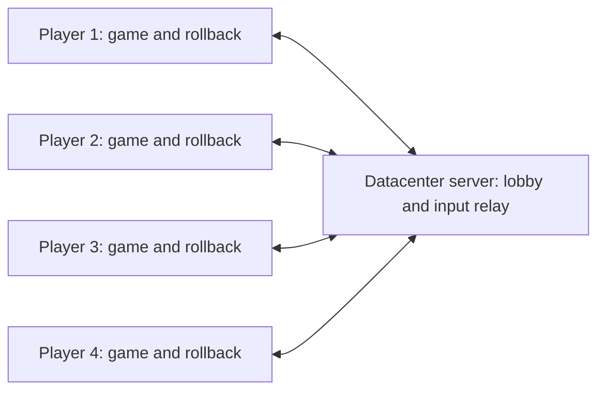

# Minimal dedicated-server lobby and player assignment

Status: step 1 in progress, 2026-10-25. No server has been rented or deployed.

## Implementation record

- Lifecycle choice: persistent external lobby owner with one fresh game process
  per match. `src/online/game_session.{hpp,cpp}` implements POSIX process ownership,
  isolated settings/ROM copies, cleanup, loading deadline, cancellation, exit/crash
  recovery, and monotonically increasing match IDs. No native checkpoint crosses
  a process boundary. The private game acknowledgment channel is tested; the
  lobby UI and real network connection are not built.
- `sh tests/run_game_session_tests.sh` passes at `-O0` and `-O2`: loading cancel
  before/after readiness, acknowledged start/finish, crash, failed launch,
  repeated launch, stale event rejection, malformed/duplicate events, loading
  timeout before/after readiness, cleanup, and a surviving local socket endpoint.
  The private channel handles fragmented/coalesced messages and peer closure
  without killing the owner. `BM64_SESSION_REAL_GAME=1` now cancels a real load,
  then completes **two real first-to-three matches** through the same owner. Both
  stop at Player Select boundary 1374 until Start, have identical initial guest
  digests, finish at 5401, and clean up their private settings. This is scripted
  lifecycle evidence, not a live-input, real-server, or cross-machine claim.
- Existing combined build (SHA-256
  `b6c4fec93b37134470f15fc56f6c8a94d1086fea05e9544fe6d1d21879d72326`): controller
  checks (44 calibration, 67 routing/config), 6,885 input timing checks at each
  optimization, coroutine checks, and the complete `run_battle_replay.sh` pass.
  This includes input/stack negative controls, boot handoff rewind, entry transition,
  400-frame replay, and the rolling history. Full-RAM baselines match across the
  existing independent runs. macOS game probes require audio/graphics access;
  the restricted invocation failed opening CoreAudio before simulation.
- Step 1 remaining: independent native continuation/runtime-state coverage;
  remaining configuration/UI
  audit; two-machine comparison. The timed update-1600 marker
  is not accepted as proof of character selection. The current process owner is
  exercised by tests, not yet wired into the application or a network lobby.
- Comparable diagnostic: `python3 tests/run_independent_clients.py` passes on
  build `a0ee1058f277c7d23dc921ee4e8a4272b0947462fa5845efc52129bc75ed4eae`.
  Two fresh processes match all 747 boundaries (1599–2345), covering the menu
  handoff, battle entry, and active battle. A third fresh process changes P1's
  recorded input at 1950 and first diverges at 1951. Each also passes three
  same-process full-RAM/register restores across the entire 747-update window.
  `COMPARABLE_V1` retains all 512 MiB of RAM and every architectural register;
  only the understood `f_odd` self-reference is encoded by logical identity.
  Unsupported references fail. The separate diagnostic also records logical
  process/thread identity and clocks; it does **not** certify native continuation,
  runtime queue, or GPU state across machines. No arbitrary RAM range is excluded.
  Log comparison refuses incomplete/duplicate histories, changed executables,
  different executable hashes, or different input recordings (except the explicit
  negative control). `python3 tests/test_independent_client_logs.py` covers these
  rejection paths, so a Windows build cannot accidentally pass as the tested Mac build.
- Scene inspection exposed a real blocker: the normal threaded `--single-battle`
  handoff at update 1600 displays **Stage Select / Rock Garden**, not character
  selection. Capturing at the exact handoff is black because fast boot suppresses
  both display lists and screen updates; waiting for presentation alone cannot
  display a frame that was never drawn. With handoff 1400, a held capture at 1402
  visibly confirms **Player Select** in the deterministic runtime as well.
  Disposable captures are under `build/experiments/`; an online start acknowledgment
  with a scene predicate is still required before synchronized start.
- Loading timeout and owner-destruction cleanup now have focused regressions at
  both optimization levels. The only available second machine is Windows (user
  confirmed); matching Mac/Windows determinism and a Windows process backend are
  unproven. This does not satisfy the plan's same-platform two-machine gate.
- `BM64_BOOT_HANDOFF_FRAME=1400 BM64_CAPTURE=1 python3 tests/run_single_battle_probe.py`
  visibly reaches **Player Select**, before the scripted A press at 1500. The
  default update-1600 handoff is preserved for existing fixtures; its log now
  correctly says the scene is unverified. `BM64_TRACE_MENU=1` records the active
  menu process for investigation, not as a certified scene predicate.
  Source inspection shows overlay 3/3 helpers at `0x800432A0` and `0x800432F0`
  OR all four controllers together. The accepted P1-only shared-menu behavior
  therefore still needs explicit input filtering; controller routing alone is insufficient.
- `--online-test` now requires a fresh isolated folder containing only the ROM,
  so existing saves, settings, and gameplay mods cannot enter startup. It forces
  all seven cheats off, refuses their setters, hides the cheat form, and keeps
  game-facing aspect-ratio queries at the original ratio. Ordinary offline mode
  does not enable these overrides. `python3 tests/run_match_settings.py` passes:
  attempts to enable all cheats at boundary 1940 leave the subsequent full-RAM
  and canonical-register hashes unchanged; personal settings remain byte-identical.
  Real-process lifecycle tests pass with this mode enabled. Remaining configuration
  paths and the visual disabled-cheat UI still need review; this is not a complete
  immutable-settings or playable-client claim.
  Updated build `aeb55dcf653455ebed1800eff36e3b0136dd4e033eacffa595088601f62dfa64`
  also passes the complete `run_battle_replay.sh` suite and both optimization levels
  of the input timing and comparable-context unit checks.
- The recorded battle eliminates three players by 2220 and enters overlay 17
  by 2340, remaining there through a no-input run to 6000. This narrows the result
  transition investigation. A held capture at 2500 shows P4 receiving a star;
  P1's A at 3000 enters another four-human battle by 3060. **Overlay 17 alone is
  a round-result signal, not match completion.** Do not return to the lobby there.
- `python3 tests/run_online_transition_tests.py startup` passes two independent
  histories at 1381–1580, three full-state restores per process, and an altered-input
  negative control. It covers Player Select through Stage Select, including the
  earlier boot handoff. The menu-process trace guards this specific tested fixture;
  it is not a general-purpose scene detector.
- `python3 tests/run_online_transition_tests.py round` covers result acknowledgment
  through the next battle (2941–3180): independent full-RAM/canonical-register
  histories match, three same-process restores pass, and omitting native stacks
  diverges. `tests/fixtures/battle-next-round.txt` adds the result acknowledgment.
  Both transition checks used build
  `2aec316eddf5b88cc7ba9962e8aaa7735ecc29109d0fae208749da988aef339e`.
  Held-frame captures now drain pending presentation first; a four-update replay
  with a held capture on every traversal still passes full-state comparison.
- User confirmed the first version uses fixed player colors and P1 advancing the
  existing shared menus. Lobby assignments lock human/CPU seats; independent
  character-selection controls are outside this first version.
- Player Select now has explicit entry/input-loop/exit hooks in `bm64.us.toml`.
  The marker is captured/restored with the simulation and included in both state
  digests. `BM64_BOOT_TO_PLAYER_SELECT=1` (also the `--online-test` default) ends
  scripted boot at the first boundary after the real input loop is reached,
  update 1374 in this fixture. A capture at 1402 confirms the visible screen;
  the 1301–1580 startup regression covers entry, boot handoff, and exit at 1501.
  It passes independent histories, three full-state restores, and changed-input
  negative control. The old register-trace heuristic is removed.
- `tests/fixtures/battle-finish.txt` completes three ordinary rounds using controller
  input alone. P4 reaches three stars, then P1 acknowledges the final round at
  5400. Boundary 5401 changes from round-result scene 20 to winner scene 21;
  a capture at 5550 shows WIN. `online::BattleState::complete()` accepts only the
  tested first-to-three single-battle winner, checking overlay, scene, preset,
  and scores; the third star on the round-result screen alone is insufficient.
  `python3 tests/run_online_transition_tests.py match` passes two independent
  histories at 5381–5540, three full-state restores each, and the omitted-stack
  negative control. Both updated startup and match checks used build
  `d13b9448088ab0f2ef6e223e5cb042a868c6ab33f941276e348ee1c9b8191d73`.
  Battle-state assertions, log-validation tests, input-timing and coroutine checks
  also pass; the last two run at both optimization levels.
- Music/effects volume is applied inside guest libaudio events and changes RAM.
  Online match overrides now keep music/effects/voice balance at 100, refuse their
  setters, and hide those controls; Main Volume remains adjustable on the host.
  `python3 tests/run_match_settings.py` passes four real-game runs: online cheat
  and sound changes leave full RAM/register state unchanged, while the offline
  sound-change negative control diverges. Main Volume remains adjustable in both
  modes and personal settings remain untouched. The disabled sound UI still needs
  visual inspection; live audio output/replay deduplication remains step 3 work.
- The session owner now receives a bounded Ready message with match ID, actual
  frame, and comparable state digest. Start must acknowledge that exact state;
  the child stays suspended at the game-loop boundary while waiting. A valid
  Finished event ends the disposable child and returns the owner to Lobby.
  Wrong-match, duplicate, out-of-order, or disconnected-channel events abort and
  clean up. Ordinary child exit cannot be mistaken for normal match completion.
  IPC is private to one process pair, separate from a future network protocol,
  and never sends native checkpoints. The owned path currently accepts scripted
  diagnostic inputs and refuses diagnostic restores; live rollback completion
  still needs the network's confirmed frontier. No online UI is wired yet.
  Real lifecycle proof used unchanged build
  `ef1b91d0ac4c8f2bb64b7289ababf94ad806ae1e5d850fd291f298a0ee96d3da`.
  This build also passes the complete `sh tests/run_battle_replay.sh` suite:
  1/4/8/12-update restores, 400-update lifecycle, boot and battle entry, both
  negative controls, independent overlapping RAM hashes, and rolling history.
- Fixed colors and human/CPU seats now apply before Player Select builds its rows.
  `BM64_ONLINE_HUMANS=2|3|4` is validated, and the owner supplies the agreed count.
  P1 alone can confirm shared menus/results; directions, seat/costume edits, and
  the ROM pause menu are blocked online. CPU pads stay neutral. Offline controls
  are unchanged. Checkpoints now restore the overlay used by this input policy.
  The layout checks pass all six 2/3/4-human baseline/interference runs, two round
  transition runs, and an offline negative control (first divergence 1401), each
  with full-state restores. A held two-human capture visibly shows MAN/MAN/COM/COM.
  O0/O2 input-policy and owner checks, two complete real owned matches, and a
  400-update rolling-history check pass on unchanged executable SHA-256
  `379c51898ff87054a26f05275bab2b0bad22fe234aaf795518aa851546ce1e85`.
- Step 2 server preparation has begun while the remaining step 1 gates stay open;
  no playable-network claim is made. Preserve concurrent renderer/runtime experiments.

## Goal and boundary

Let two to four people join one private room with fixed player colors and finish real
Bomberman 64 battles through a rented datacenter server. Use this to judge feel
before doing more speculative renderer optimization.

The server owns the room, assigns players, coordinates starts, and relays inputs.
Every client runs the full game and its own rollback. The server does not run the
ROM, render frames, hold checkpoints, or decide battle outcomes. This gives all
four players the same networking role without requiring a headless recomp port.
A server that independently simulates and arbitrates gameplay would be a separate,
larger project. This first version is for trusted friends, not competitive anti-cheat.

## What players see

One **Online Battle** screen has a server address, display name, and Connect button.
The first deployment uses one room at that address. There are no accounts, room
browser, matchmaking, or room-creation service.

After joining, show four rows containing player number, name, connection status,
and Ready status. Unoccupied rows say **CPU**. Each player has Ready and Leave;
Player 1 also has Start, enabled only with two or more humans and everyone ready.
Show connection delay to the server, explicitly labeled as such.

Start launches the game's existing single-battle character selection with the
agreed human/CPU layout and fixed player colors. Player 1 operates the existing
shared menus; other players cannot change those menus or human/CPU assignments. The first version uses one tested battle preset, with CPU
players filling unused slots; do not duplicate stage/rules menus in the lobby.

## Exact assignment rules

| Event | Server behavior |
| --- | --- |
| First accepted connection | Assign P1; this player gets permission to press Start. |
| Next connections | Assign P2, then P3, then P4. |
| Fifth connection | Reject with “Room full.” Do not replace anyone. |
| Player leaves before loading | Remove them and compact the remaining join order into P1…Pn. Publish the new roster and clear everyone's Ready status. |
| New player joins | Append to the roster and clear everyone's Ready status. |
| Loading or playing | Lock membership and assignments. Reject new joins with “Match in progress.” |
| Match ends normally | Keep assignments and connections; return everyone to the lobby with Ready cleared. |
| Player disconnects during loading/play | Abort that match and return connected players to the lobby. Compact slots and require everyone to ready again. |
| Server restarts/disconnects | End the session; clients reconnect manually. |

The server serializes joins, so simultaneous requests cannot claim the same slot.
Names are labels, not identities. Each connection gets a server-issued identity;
only the server assigns its player slot. Publish the entire small roster with an
increasing revision number. Ready and Start refer to that revision, so a delayed
message cannot approve a different roster.

A player's chosen local controller or keyboard always drives their assigned
**online** slot. A joining person's first physical controller can drive P3; it
must not accidentally drive local P1 as well. Initial scope is one human per
client. CPU slots are simulated identically on every client and send no inputs.

P1 is just the person allowed to press Start and operate existing shared menus.
P1 gets the same two-update input buffer and prediction rules as everyone else.
If P1 leaves the lobby, the next player becomes P1; there is no server migration.
No seamless reconnect, mid-match replacement, or switching a disconnected human
to CPU is included initially.

## Room lifecycle and synchronized start

Use three states: **Lobby → Loading → Playing → Lobby**. Every match has a fresh
match ID; packets from an earlier match are ignored.

1. On connection, check protocol version and a compatibility fingerprint covering
   game/ROM hash, recomp and patches, runtime version, deterministic configuration,
   and supported client platform. Start with one tested client build/platform.
   Reject mismatches before allocating a playable seat. Do not send ROM data.
2. P1 requests Start for the current roster revision. The server validates all
   Ready flags, locks the roster, and publishes the match ID, ordered roster,
   fixed battle preset, deterministic seed/time origin, and two-update input buffer.
   Revalidate and freeze the gameplay configuration for this match; the connection-
   time fingerprint alone is insufficient.
3. Every client starts a fresh deterministic game session with isolated match
   settings/save state. It reaches the same boundary immediately before live
   character-selection input. Controller presence and CPU settings must match.
   Do not synchronize local native checkpoints across machines: they contain
   process-specific addresses.
4. Clients acknowledge the agreed configuration and comparable initial-state
   digest. The server requires all acknowledgments before committing the start.
   A load failure, disconnect, mismatch, or 30-second loading timeout returns the
   room to the lobby with a useful error.
5. Send a future server-time start epoch after measuring client clock offsets and
   round-trip delays. Clients map it to local monotonic time. Handle a late start
   explicitly rather than silently granting one client a lead. Frame numbers,
   not wall-clock equality, identify game inputs; bounded lead prevents drift.

In step 1, choose and document the actual session lifecycle: a persistent lobby
and connection owner with a fresh game process per match, or an explicit runtime
teardown/reset path. Use the smallest approach that passes the lifecycle tests.
The current runtime starts once, `quit()` exits the application, and replay probes
terminate the process; calling `start_game()` again is not a reset implementation.
Prove **start → abort/finish → lobby → start again**, including cancellation during
loading, before building the lobby around that choice. Keep the room connection
and identity alive, release old runtime/checkpoint state, and reject old-match
events after restarting. Exercise ownership with a local test session in step 1;
verify real connection retention in step 2. If using a separate game process, its
crash must return the surviving session owner to the lobby rather than leave a
playable seat stuck in Loading.

Define and test the actual character-select boundary before networking it; the
current boot-handoff marker alone is insufficient.
Initially, Exit Online Battle cancels the match for everyone. Detect normal match
completion at a confirmed simulation frame, then have all clients return to the
external lobby. This needs an explicit round/match-transition integration test.

Match settings are immutable from Loading until the match ends. Disable cheats
and gameplay mods for the first version, and prevent local settings UI or config
reloads from changing simulation-affecting values. Allow local volume, display,
and controller calibration changes only where they do not change the shared
simulation. Use isolated overrides without overwriting personal settings; restore
normal settings on completion, abort, or failed loading. Test an attempted mid-match
cheat change and verify both simulation consistency and settings restoration.

## Input transport and rollback

Use one small C/C++ server executable, built independently of the game and renderer.
The proposed transport is pinned upstream **ENet**, providing reliable control
messages and separate UDP channels without writing connection management from
scratch. ENet documents reliability and independent channels in its
[design notes](https://github.com/lsalzman/enet/blob/master/docs/design.dox);
its [upstream repository](https://github.com/lsalzman/enet) provides the implementation.
Pin and test a specific revision during implementation; do not add a second transport.

- Use reliable ordered control messages for joining, roster snapshots, readiness,
  preparation/start, and match termination. Bound message sizes and queue lengths.
- Send frame-numbered controller inputs over a separate unreliable channel per
  player stream, with recent inputs repeated in each packet. Start with a 32-frame
  input history and a packet size cap below 1,200 bytes. Continue resending while
  simulation is stalled, so loss can recover without advancing the game.
- The server binds each input stream to its connection's assigned slot. Validate
  frame bounds, input ranges, match ID, and size; reject conflicting replacements
  for an already accepted slot/frame. Forward accepted inputs immediately to the
  other clients; do not wait for all four inputs or batch on a server frame tick.
- Identical repeats within retained history are valid and must be forwarded again,
  not discarded merely because the server already accepted that slot/frame. This
  repairs loss on the server-to-client leg. Clients deduplicate identical inputs
  without applying them twice. Keep resending on a bounded cadence while stalled;
  retire input history only after the receiving clients' contiguous acknowledgments
  make it safe. A server receipt alone does not prove delivery to every client.
- Clients sample their own inputs once and schedule them two updates ahead. They
  do not wait for a server echo to apply their own input. Remote predictions hold
  the last known input; corrections restore the earliest affected checkpoint and
  replay every update, presenting only the final result.
- Track contiguous received inputs and a shared confirmed frontier. Bound progress
  ahead of the slowest client's confirmed frontier, not just ahead of the server's
  receive position. An initial maximum of 12 speculative updates must fit within
  the existing 16-slot checkpoint ring, with a checked slot-lifetime invariant.
  The two-update input scheduling offset must be included in the history sizing.
- Stop advancing before needed history could be overwritten. Continue network
  service and show “Waiting for connection.” If progress cannot resume within five
  seconds, abort to the lobby. Do not discard missing inputs, silently enlarge
  input delay, or keep predicting beyond recoverable state.

The exact frame-boundary convention, acknowledgment fields, and history arithmetic
need focused tests before integration. They are not reasons to build a generic
network framework. Keep network input history separate from rollback state so a
restore cannot forget newly received packets. Network polling must remain active
during replay and loading, without injecting nondeterministic events into simulation.

Before playable two-client integration, add deterministic four-client input-history
and relay tests with independently scheduled deliveries: P2 late, P3 arriving during
P2's correction, P4 reordered or duplicated, checkpoint-ring wraparound, and stalled
retransmission. Drop only server-to-P3 traffic in one case: input already accepted
by the server must still reach P3 after recovery. Check the earliest required
rollback, corrected state against an all-inputs-known reference, and bounded
history/queues. Define neutral inputs for the initial scheduling gap and exclude
CPU slots from network acknowledgment requirements so startup cannot deadlock.

## Renting and running the server

Start with one small Linux VM in a region reasonably close to the group, one
server process, and one configured UDP port. No GPU, game ROM, database, web app,
or container orchestration is needed. Measure resource use before choosing a
larger instance; this plan does not depend on a particular provider or price.

For the first private playtests, restrict that port to the testers' public IPs and
run the service as an unprivileged user with automatic restart and bounded logs.
ENet is not an authentication/encryption system; do not treat a room name or a
plaintext join password as public-service security. If IP restrictions become
impractical, add an authenticated encrypted access layer before opening access
widely. This does not require account infrastructure for the first trial.

All clients connect outward to the server, avoiding a player-hosted inbound port
and peer-to-peer NAT traversal. A relay can increase travel time: an input follows
player A → datacenter → player B. Under approximately symmetric paths, half of
A's server RTT plus half of B's server RTT estimates that one-way route, before
jitter and processing. Measure it; the server does not eliminate distance or make
four-player rollback cheaper. The current fixture predicts all three remote pads,
but uses one shared delivery-gap schedule; it does not cover independent packet
arrivals or loss on individual relay connections.

## Implementation order and acceptance

| Step | Deliverable | Acceptance |
| --- | --- | --- |
| 1. Independent-client correctness and lifecycle | Choose and prove session restart/teardown; fresh deterministic startup and recorded-input replay on two independent processes, then two machines using the current shared/controller build. | Matching comparable state through character selection, battle, and round transitions; start → abort/finish → lobby → start again, including loading cancellation; immutable match settings and personal-settings restoration; existing full-state replay and negative controls still pass. |
| 2. Server, lobby, and input-history tests | Standalone server, four-seat roster, Connect/Ready/Start/Leave screen, revisioned assignments, compatibility rejection, and deterministic four-client delivery tests. | Automated 2/3/4-client joins, concurrent joins, full-room rejection, reassignment, stale Ready/Start, loading failure, and disconnect cases; independently delayed/reordered/duplicate inputs, server-to-P3 loss recovery, arrivals during replay, stalled retransmission, and history wraparound pass before step 3. |
| 3. Playable two-client battle | Live controller remapping, input relay, bounded prediction/catch-up, and match start/end. | Two people complete repeated matches; no slot mixing, desyncs, duplicate rollback audio, or stuck loading/round transitions. |
| 4. Four-client datacenter playtest | Same room and protocol with four humans on separate machines; controlled delay/loss plus a real remote session. | At least ten complete matches and 30 minutes of play; capture diagnostics and human feedback, including disconnect recovery. |
| 5. Evidence-based follow-up | Compare ordinary local, online with no late corrections, and real-network rollback. | Decide whether current feel is acceptable and identify the dominant measured problem before further optimization. |

Independent-process comparison needs a deliberate state representation. Keep the
existing full-RAM and register replay checks unchanged. Native pointers/stack
addresses cannot be compared naively across processes: normalize only understood
process-local references in a separate network diagnostic, retaining their logical
identity, or reject the unsupported representation. Test that this diagnostic
still detects deliberate divergence; never omit arbitrary RAM ranges to pass it.
Full-memory hashing is a correctness mode, not work to perform on every rendered
frame. Measure the overhead of any periodic live desync checks separately.

A playable match also requires enabling real audio and handling replayed audio and
rumble without duplicates; the existing experiment suppresses output. Record any
confirmed-audio delay separately. Verify that replay suppression preserves required
framebuffer results and completion events, and inspect visual history artifacts.
Neither transport nor a lobby solves those existing integration gaps.

For playtests record RTT/jitter/loss per connection, correction depth/frequency,
CPU and display deadline misses, frame-gap tails, held/displayed-state age, buffer
size, stalls, desyncs, and post-hitch recovery. Keep the buffer at two for comparisons.
Include several hundred correction events across fresh runs, keep 8/12 updates as
stress cases, and preserve the fully drained diagnostic. Report physical input-to-
photon latency only if actually measured; the previous ~66.7 ms figure is an estimate.

The earlier single-remote-stream four-update p99 was 17.54 ms; it does not establish
performance for the current three-remote-pad fixture or a real four-client session.
This is an experimental playtest milestone, not a declaration of reliable 60 Hz
support. Performance failure does not block collecting honest feel feedback;
desynchronization does block a valid match.

## Deferred until the prototype answers the feel question

Multiple rooms, player-selected slots, multiple local humans per client, spectators,
join-in-progress, seamless reconnect, public matchmaking/accounts, ranked play,
server-authoritative simulation, cross-platform support, and adaptive input delay.
The fixed four-seat roster already supports two through four players without any
of these features. The immediate next implementation is step 1, followed by the
small server/lobby; further renderer optimization is deferred pending playtest data.
